# vegas

This repository is the source of Fallout: New Vegas, rebuilt from the original release, and it builds a native game for each build target. The game needs a data pack that setup prepares from the player's own copy of the original release, and the repository never contains an original file or data read from one.

## Startup and blocker map

The diagram shows how `FalloutNV` starts at the snapshot commit, from the pack that `vegas-setup` prepares to the second-window check. It also shows what the next stage of engine initialization waits on. `tools/startup-map` generates the diagram from `tools/startup-map/map.json`, so edit that file and not the diagram.

```mermaid
flowchart TB
  subgraph setup_step["Setup"]
    setup_prepare["vegas-setup prepares vegas-data.pack, catalogue version 2<br/>ACCEPTED, windows-executed, VEGAS-13"]
    setup_install["vegas-setup installs the pack beside FalloutNV.exe<br/>ACCEPTED, windows-executed, VEGAS-13"]
  end
  subgraph startup_step["Accepted startup steps"]
    main_memory["Step 1: Memory start-up, StartProcessMemory<br/>ACCEPTED, windows-executed"]
    main_timer["Step 2: Game timer start<br/>ACCEPTED, windows-executed, VEGAS-70"]
    main_folder["Step 3: Folder of the executable, GetModuleFileNameW<br/>ACCEPTED, windows-executed, VEGAS-52"]
    main_pack["Step 4: Pack load and validation, catalogue version 2<br/>ACCEPTED, windows-executed, VEGAS-52"]
    main_publish["Step 4: Publish C1 and the main window class to their owners<br/>ACCEPTED, windows-executed, VEGAS-52"]
    main_single["Step 5: Single-instance and remote-session checks<br/>ACCEPTED, windows-ci-test, VEGAS-52"]
    main_second["Steps 6 and 7: Second-window check, then main returns 0<br/>ACCEPTED, windows-ci-test, VEGAS-52"]
  end
  subgraph winmain_statement["WinMain statements main skips"]
    s1["S1 crash-log configuration, FUN_00c3bd30<br/>WAITING, lazy-link, VEGAS-52"]
    s2_s5["S2 to S5, the four log paths<br/>WAITING, lazy-link, VEGAS-52"]
    s6["S6 GetSystemInfo, processor count into its setting<br/>WAITING, lazy-link, VEGAS-52"]
    s7["S7 BGSSaveLoadManager::GetSaveDirectory<br/>WAITING, lazy-link, VEGAS-52"]
    s8["S8 processor count of 1 set to 2<br/>WAITING, lazy-link, VEGAS-52"]
  end
  subgraph boot_body["Boot bodies"]
    winmain["WinMain 0x0086a850, misc/main.cpp<br/>BLOCKED, lazy-link, VEGAS-30"]
    mainloop["Main loop 0x0086e650, FrameUpdate::MainLoop<br/>BLOCKED, lazy-link, VEGAS-30"]
    bootinit["BootInit 0x0086cf20<br/>BLOCKED, lazy-link, VEGAS-30"]
    render["Render set-up 0x0086d590, RenderSystem<br/>BLOCKED, lazy-link, VEGAS-30"]
    wndproc["Window procedure 0x0086a0a0<br/>BLOCKED, lazy-link, VEGAS-30"]
  end
  subgraph contract["Contracts"]
    c_calls_bound["Calls of 0x008774a0, 0x008707c0 and 0x00870bd0 repaired and bound to their rows<br/>ACCEPTED, object-check, VEGAS-90"]
    c_call_repair["Call repairs that change a conversion on main.cpp calls<br/>READY, curated, VEGAS-90 Needs triage"]
    c_870bd0["0x00870bd0 definition repaired, texture parameter void*, call bound<br/>ACCEPTED, object-check, VEGAS-97"]
    c_870a00["0x00870a00 call waits on a shared declaration of the texture type<br/>WAITING, source, VEGAS-97"]
    c_shared_classes["Shared declarations of the 12 classes the boot bodies construct<br/>WAITING, source, VEGAS-30"]
    c_niobject["Shared NiObject with its virtual slot table<br/>WAITING, source, VEGAS-30"]
    c_niobjectnet["Shared NiObjectNET with its virtual slot table<br/>WAITING, source, VEGAS-30"]
    c_niproperty["Shared NiProperty with its virtual slot table<br/>WAITING, source, VEGAS-30"]
    c_niavobject["Shared NiAVObject with its virtual slot table<br/>WAITING, source, VEGAS-30"]
    c_ninode["Shared NiNode with its virtual slot table<br/>WAITING, source, VEGAS-30"]
    c_player["Type the placeholder fields of PlayerCharacter 0x00938180<br/>WAITING, source, VEGAS-30"]
    c_tes["Type the placeholder fields of TES 0x00450770<br/>WAITING, source, VEGAS-30"]
    c_hand_tables["Constructors that store a table address by hand<br/>WAITING, curated, VEGAS-110 Needs triage"]
    c_setting_t["SettingT accessor 0x00408d60 through main.cpp stand-ins<br/>IN-PROGRESS, curated, VEGAS-70 In progress"]
    c_receiver["Receiver and size of g_osGlobals, RenderSystem, FUN_008706b0<br/>UNKNOWN, source, VEGAS-30"]
    c_differing["No name a main.cpp program keeps has differing definitions<br/>READY, curated, VEGAS-89 Ready for agent"]
    c_dup_checks["Drop the duplicated startup checks from main or from WinMain<br/>UNKNOWN, source, VEGAS-52"]
  end
  subgraph gate["Gates"]
    g_main_obj["A linking program contains misc/main.cpp.obj<br/>BLOCKED, lazy-link, VEGAS-30"]
    g_engine_link["runtime_havok_worker_pool_test links, the engine-link gate<br/>BLOCKED, windows-ci-test, VEGAS-30"]
    g_next["main runs WinMain's next stage: window, BootInit, render set-up, main loop<br/>BLOCKED, source, VEGAS-30"]
    g_menu["Boot to the main menu<br/>BLOCKED, curated, VEGAS-30"]
  end
  subgraph ticket["Tickets"]
    t_vegas109["DAT_01202fa0, the user folder buffer, defined as 260 bytes<br/>ACCEPTED, object-check, VEGAS-109 Done"]
    t_vegas112["DAT_01202b48 and DAT_01202e98 defined as a byte and an int, written as 260-byte buffers<br/>READY, curated, VEGAS-112 Needs triage"]
    t_vegas111["FUN_0043d4d0 reads the setting value at plus 8; 286 calls stay on the old form<br/>IN-PROGRESS, object-check, VEGAS-111 In progress"]
    t_vegas115["41 calls of FUN_0043d4d0 in main.cpp, S6 and S8 among them, on the old form<br/>READY, source, VEGAS-115 Needs triage"]
  end
  setup_prepare --> setup_install
  setup_install --> main_pack
  main_memory --> main_timer
  main_folder --> main_pack
  main_pack --> main_publish
  main_publish --> main_single
  main_single --> main_second
  c_setting_t ==>|blocks| s1
  t_vegas109 -.-> s2_s5
  t_vegas112 -. "blocks" .-> s2_s5
  t_vegas112 -. "blocks" .-> s7
  t_vegas115 -. "blocks" .-> s6
  t_vegas115 -. "blocks" .-> s8
  t_vegas115 -.-> t_vegas111
  winmain -->|calls| mainloop
  winmain -->|calls| bootinit
  winmain -->|calls| render
  winmain -->|calls| wndproc
  g_main_obj --> winmain
  c_calls_bound --> g_main_obj
  c_call_repair ==>|blocks| g_main_obj
  c_870a00 ==>|blocks| g_main_obj
  c_shared_classes ==>|blocks| g_main_obj
  c_setting_t ==>|blocks| g_main_obj
  c_receiver -. "blocks" .-> g_main_obj
  c_differing -. "blocks" .-> g_main_obj
  c_870bd0 -.-> c_call_repair
  c_niobject --> c_niobjectnet
  c_niobjectnet --> c_niproperty
  c_niobjectnet -.-> c_niavobject
  c_niavobject -.-> c_ninode
  c_ninode -.-> c_shared_classes
  c_niproperty -.-> c_shared_classes
  c_player -.-> c_shared_classes
  c_tes -.-> c_shared_classes
  c_hand_tables -. "blocks" .-> c_shared_classes
  c_ninode -.-> c_hand_tables
  c_niproperty -.-> c_hand_tables
  g_main_obj --> g_engine_link
  main_second --> g_next
  winmain --> g_next
  c_dup_checks -.-> g_next
  g_next -.-> g_menu
  c_player -. "estimate of 40 closure names" .-> bootinit
  c_tes -. "estimate of 27 closure names" .-> winmain
  classDef accepted fill:#d8f0d8,stroke:#2e7d32,color:#000
  class setup_prepare,setup_install,main_memory,main_timer,main_folder,main_pack,main_publish,main_single,main_second,c_calls_bound,c_870bd0,t_vegas109 accepted
  classDef in_progress fill:#e6dcf5,stroke:#5e35b1,color:#000
  class c_setting_t,t_vegas111 in_progress
  classDef ready fill:#fff4c2,stroke:#a07800,color:#000
  class c_call_repair,c_differing,t_vegas112,t_vegas115 ready
  classDef waiting fill:#ffe2c4,stroke:#c25e00,color:#000
  class s1,s2_s5,s6,s7,s8,c_870a00,c_shared_classes,c_niobject,c_niobjectnet,c_niproperty,c_niavobject,c_ninode,c_player,c_tes,c_hand_tables waiting
  classDef blocked fill:#f8d4d4,stroke:#b71c1c,color:#000
  class winmain,mainloop,bootinit,render,wndproc,g_main_obj,g_engine_link,g_next,g_menu blocked
  classDef unknown fill:#e8e8e8,stroke:#616161,color:#000
  class c_receiver,c_dup_checks unknown
  classDef curated stroke-dasharray:6 4
  class c_call_repair,c_hand_tables,c_setting_t,c_differing,g_menu,t_vegas112 curated
```

<!-- startup-map:begin (generated by tools/startup-map; do not edit) -->

Each box shows its state in capitals, its evidence tier and its ticket. The tiers name distinct kinds of evidence. When a tracker state follows the ticket, the box takes its state from the tracker, and every other box takes its state from the repository.
An unlabelled arrow points from what is needed to what needs it. A `blocks` arrow starts at the blocker, a `calls` arrow at the caller and an `estimate` arrow at the work.
A dashed box or arrow is curated, which means that a person stated it and no machine check proves it. Estimate arrows are dashed too, and they are modelled counts.

The map is a snapshot of `c3ad69b43` with evidence as of 2026-11-13. [docs/startup-map.md](docs/startup-map.md) lists every node, edge, source and limitation.

<!-- startup-map:end -->
