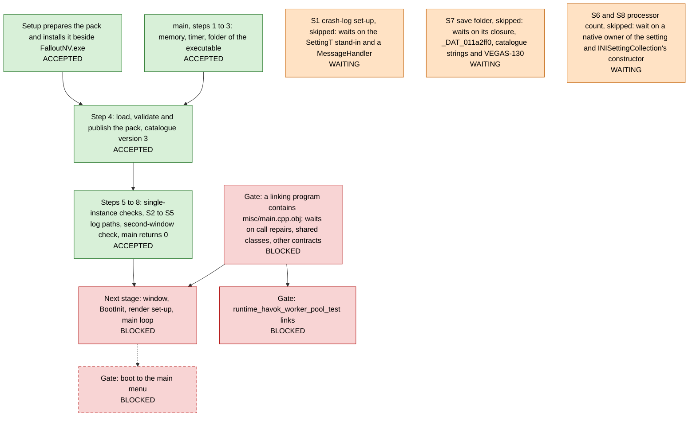

# vegas

This repository is the source of Fallout: New Vegas, rebuilt from the original release, and it builds a native game for each build target. The game needs a data pack that setup prepares from the player's own copy of the original release, and the repository never contains an original file or data read from one.

## Startup and blocker map

The diagram shows how `FalloutNV` starts at the snapshot commit, from the pack that `vegas-setup` prepares to the second-window check. It also shows what the next stage of engine initialization waits on. `tools/startup-map` generates the diagram from `tools/startup-map/map.json`, so edit that file and not the diagram.

<!-- startup-map:begin (generated by tools/startup-map; do not edit) -->

Each box stands for one or more nodes of the full map and shows their state in capitals. An arrow points from what is needed, or from a gate that holds a statement, to what waits on it. A dashed box or arrow is curated, which means that a person stated it and no machine check proves it.

The map is a snapshot of `60edb2e9a` with evidence as of 2026-11-14. [docs/startup-map.md](docs/startup-map.md) has the full diagram and lists every node, edge, source and limitation.

<!-- startup-map:end -->
