# Startup and blocker map

<!-- Generated by tools/startup-map from tools/startup-map/map.json; do not edit. -->

This page shows how `FalloutNV` starts at the snapshot commit, from the data
pack that setup prepares to the second-window check. It also shows the statements
of `WinMain` that `main` skips, and what the next stage of engine initialization
waits on. The next stage waits on the boot bodies that `WinMain` reaches by name
and on the contracts and gates that stop them. The page is a derived view, and nobody edits
it by hand. The tracker holds tickets, criteria and rulings. The documents under
`docs/` record code relationships, and git and CI record accepted commits and
checks. Each node names its source.

## Snapshot

The snapshot commit is `3503a01a13615f0c6125f7038d6d9b119a830b80`. The evidence is as of
2026-11-13, and the ticket states are those the tracker showed on 2026-11-13.

After you edit `tools/startup-map/map.json`, refresh the page and check it:

```text
python3 tools/startup-map/startup_map.py
python3 tools/startup-map/startup_map.py --check
```

## Legend

A node has one of these states.

| State | Meaning |
| --- | --- |
| accepted | The snapshot commit has it, and the evidence of its tier covers it. |
| in-review | Its work is written and under review. The snapshot commit does not have it. |
| in-progress | Its ticket is in progress in the tracker. The snapshot commit does not have it. |
| ready | Work on it can start now, because no `requires` or `blocks` edge makes it need an unfinished node. |
| waiting | It waits on a named contract, ruling, owner or ticket. |
| blocked | It requires nodes that are not done, and it cannot be done before they are. |
| unknown | No source records a route or an owner for it. |

A node with a tracker state takes its state from the tracker. That state is the
one its ticket had on the ticket-state date, mapped as the table below shows.
Every other node takes its state from the repository at the snapshot commit. It
is `accepted` when the commit has it with the check its source cites, and
otherwise `waiting`, `blocked` or `unknown`. A gate always takes its state from
the repository, and its ticket is a reference only.

| Tracker state | State on the map |
| --- | --- |
| Needs triage | It is `ready`, or `waiting` when a measured or curated `requires` or `blocks` edge makes the node need an unfinished node. |
| Needs info | It is `ready`, or `waiting` when a measured or curated `requires` or `blocks` edge makes the node need an unfinished node. |
| Ready for agent | It is `ready`, or `waiting` when a measured or curated `requires` or `blocks` edge makes the node need an unfinished node. |
| Ready for human | It is `ready`, or `waiting` when a measured or curated `requires` or `blocks` edge makes the node need an unfinished node. |
| In progress | It is `in-progress`. |
| In review | It is `in-review`. |
| Done | It is `accepted`. |

Needs info and Ready for human map as Needs triage and Ready for agent do.
The generator refuses the tracker's `Won't fix`.

The evidence tiers follow. They name distinct kinds of evidence, not steps of a scale. A node's
tier names the kind of evidence behind its state.

| Tier | Meaning |
| --- | --- |
| curated | A person stated it, and no machine check proves it. |
| source | The source shows it, or a compiler's reading of the declarations does. |
| forced-link | The forced link of every archive member shows it. That link says nothing about what a running program reaches. |
| object | An object-level proof shows it. |
| lazy-link | The ordinary, lazy link of a real executable shows it. |
| object-check | A standing `objects.*` or `archive.*` check shows it. |
| host-test | A host test shows it. |
| windows-ci-test | A test in the Windows CI job shows it. |
| windows-executed | A real run on Windows shows it. The private runs on an actual input count. |

A measurement may carry the tier `model` instead. A model, such as the boot closure, computed it,
and no link measured it.

An edge has one of these kinds.

| Kind | Meaning |
| --- | --- |
| requires | The source node needs the target node first. This is a real blocker. |
| blocks | The target node cannot finish before the source, a contract or ticket, does. |
| calls | The source refers to the target in code, for example by a call. These edges may form cycles. |
| estimated-unlock | A model estimates what finishing the source opens in the target. It is never a measurement. |

An edge is `measured`, with the kind of report it cites, `curated` or `modelled`.
Every `estimated-unlock` edge is `modelled`, and no other edge is. The diagram
draws curated edges, curated nodes and estimates dashed.
An unlabelled arrow points from what is needed to what needs it. A `blocks` arrow starts at the blocker, a `calls` arrow at the caller and an `estimate` arrow at the work.
The generator refuses a cycle of `requires` and `blocks` edges.

## Diagram

```mermaid
flowchart TB
  subgraph setup_step["Setup"]
    setup_prepare["vegas-setup prepares vegas-data.pack, catalogue version 2<br/>ACCEPTED, windows-executed, VEGAS-13"]
    setup_install["vegas-setup installs the pack beside FalloutNV.exe<br/>ACCEPTED, windows-executed, VEGAS-13"]
  end
  subgraph startup_step["Accepted startup steps"]
    main_memory["Step 1: Memory start-up, StartProcessMemory<br/>ACCEPTED, windows-executed"]
    main_timer["Step 2: Game timer start<br/>ACCEPTED, windows-executed, VEGAS-70"]
    main_folder["Step 3: Folder of the executable, GetModuleFileNameW<br/>ACCEPTED, windows-executed, VEGAS-52"]
    main_pack["Step 4: Pack load and validation, catalogue version 2<br/>ACCEPTED, windows-executed, VEGAS-52"]
    main_publish["Step 4: Publish C1 and the main window class to their owners<br/>ACCEPTED, windows-executed, VEGAS-52"]
    main_single["Step 5: Single-instance and remote-session checks<br/>ACCEPTED, windows-ci-test, VEGAS-52"]
    main_second["Steps 6 and 7: Second-window check, then main returns 0<br/>ACCEPTED, windows-ci-test, VEGAS-52"]
  end
  subgraph winmain_statement["WinMain statements main skips"]
    s1["S1 crash-log configuration, FUN_00c3bd30<br/>WAITING, lazy-link, VEGAS-52"]
    s2_s5["S2 to S5, the four log paths<br/>WAITING, lazy-link, VEGAS-52"]
    s6["S6 GetSystemInfo, processor count into its setting<br/>WAITING, lazy-link, VEGAS-52"]
    s7["S7 BGSSaveLoadManager::GetSaveDirectory<br/>WAITING, lazy-link, VEGAS-52"]
    s8["S8 processor count of 1 set to 2<br/>WAITING, lazy-link, VEGAS-52"]
  end
  subgraph boot_body["Boot bodies"]
    winmain["WinMain 0x0086a850, misc/main.cpp<br/>BLOCKED, lazy-link, VEGAS-30"]
    mainloop["Main loop 0x0086e650, FrameUpdate::MainLoop<br/>BLOCKED, lazy-link, VEGAS-30"]
    bootinit["BootInit 0x0086cf20<br/>BLOCKED, lazy-link, VEGAS-30"]
    render["Render set-up 0x0086d590, RenderSystem<br/>BLOCKED, lazy-link, VEGAS-30"]
    wndproc["Window procedure 0x0086a0a0<br/>BLOCKED, lazy-link, VEGAS-30"]
  end
  subgraph contract["Contracts"]
    c_calls_bound["Calls of 0x008774a0 and 0x008707c0 repaired and bound to their rows<br/>ACCEPTED, object-check, VEGAS-90"]
    c_call_repair["Call repairs that change a conversion on main.cpp calls<br/>WAITING, curated, VEGAS-90 Needs triage"]
    c_870bd0["0x00870bd0 definition repair, parameter int to void*<br/>IN-PROGRESS, curated, VEGAS-97 In progress"]
    c_shared_classes["Shared declarations of the 12 classes the boot bodies construct<br/>WAITING, source, VEGAS-30"]
    c_niobject["Shared NiObject with its virtual slot table<br/>WAITING, source, VEGAS-30"]
    c_niobjectnet["Shared NiObjectNET with its virtual slot table<br/>WAITING, source, VEGAS-30"]
    c_niproperty["Shared NiProperty with its virtual slot table<br/>WAITING, source, VEGAS-30"]
    c_niavobject["Shared NiAVObject with its virtual slot table<br/>WAITING, source, VEGAS-30"]
    c_ninode["Shared NiNode with its virtual slot table<br/>WAITING, source, VEGAS-30"]
    c_player["Type the placeholder fields of PlayerCharacter 0x00938180<br/>WAITING, source, VEGAS-30"]
    c_tes["Type the placeholder fields of TES 0x00450770<br/>WAITING, source, VEGAS-30"]
    c_hand_tables["Constructors that store a table address by hand<br/>WAITING, curated, VEGAS-110 Needs triage"]
    c_setting_t["SettingT accessor 0x00408d60 through main.cpp stand-ins<br/>IN-PROGRESS, curated, VEGAS-70 In progress"]
    c_receiver["Receiver and size of g_osGlobals, RenderSystem, FUN_008706b0<br/>UNKNOWN, source, VEGAS-30"]
    c_differing["No name a main.cpp program keeps has differing definitions<br/>READY, curated, VEGAS-89 Ready for agent"]
    c_dup_checks["Drop the duplicated startup checks from main or from WinMain<br/>UNKNOWN, source, VEGAS-52"]
  end
  subgraph gate["Gates"]
    g_main_obj["A linking program contains misc/main.cpp.obj<br/>BLOCKED, lazy-link, VEGAS-30"]
    g_engine_link["runtime_havok_worker_pool_test links, the engine-link gate<br/>BLOCKED, windows-ci-test, VEGAS-30"]
    g_next["main runs WinMain's next stage: window, BootInit, render set-up, main loop<br/>BLOCKED, source, VEGAS-30"]
    g_menu["Boot to the main menu<br/>BLOCKED, curated, VEGAS-30"]
  end
  subgraph ticket["Tickets"]
    t_vegas109["DAT_01202fa0, the user folder buffer, defined as 260 bytes<br/>ACCEPTED, object-check, VEGAS-109 Done"]
    t_vegas112["DAT_01202b48 and DAT_01202e98 defined as a byte and an int, written as 260-byte buffers<br/>READY, curated, VEGAS-112 Needs triage"]
    t_vegas111["FUN_0043d4d0 returns a setting's address plus 4; the x64 value is at plus 8<br/>IN-PROGRESS, curated, VEGAS-111 In progress"]
  end
  setup_prepare --> setup_install
  setup_install --> main_pack
  main_memory --> main_timer
  main_folder --> main_pack
  main_pack --> main_publish
  main_publish --> main_single
  main_single --> main_second
  c_setting_t ==>|blocks| s1
  t_vegas109 -.-> s2_s5
  t_vegas112 -. "blocks" .-> s2_s5
  t_vegas112 -. "blocks" .-> s7
  t_vegas111 -. "blocks" .-> s6
  t_vegas111 -. "blocks" .-> s8
  winmain -->|calls| mainloop
  winmain -->|calls| bootinit
  winmain -->|calls| render
  winmain -->|calls| wndproc
  g_main_obj --> winmain
  c_calls_bound --> g_main_obj
  c_call_repair ==>|blocks| g_main_obj
  c_shared_classes ==>|blocks| g_main_obj
  c_setting_t ==>|blocks| g_main_obj
  c_receiver -. "blocks" .-> g_main_obj
  c_differing -. "blocks" .-> g_main_obj
  c_870bd0 -.-> c_call_repair
  c_niobject --> c_niobjectnet
  c_niobjectnet --> c_niproperty
  c_niobjectnet -.-> c_niavobject
  c_niavobject -.-> c_ninode
  c_ninode -.-> c_shared_classes
  c_niproperty -.-> c_shared_classes
  c_player -.-> c_shared_classes
  c_tes -.-> c_shared_classes
  c_hand_tables -. "blocks" .-> c_shared_classes
  c_ninode -.-> c_hand_tables
  c_niproperty -.-> c_hand_tables
  g_main_obj --> g_engine_link
  main_second --> g_next
  winmain --> g_next
  c_dup_checks -.-> g_next
  g_next -.-> g_menu
  c_870bd0 -. "estimate of 132 closure names" .-> winmain
  c_player -. "estimate of 40 closure names" .-> bootinit
  c_tes -. "estimate of 27 closure names" .-> winmain
  classDef accepted fill:#d8f0d8,stroke:#2e7d32,color:#000
  class setup_prepare,setup_install,main_memory,main_timer,main_folder,main_pack,main_publish,main_single,main_second,c_calls_bound,t_vegas109 accepted
  classDef in_progress fill:#e6dcf5,stroke:#5e35b1,color:#000
  class c_870bd0,c_setting_t,t_vegas111 in_progress
  classDef ready fill:#fff4c2,stroke:#a07800,color:#000
  class c_differing,t_vegas112 ready
  classDef waiting fill:#ffe2c4,stroke:#c25e00,color:#000
  class s1,s2_s5,s6,s7,s8,c_call_repair,c_shared_classes,c_niobject,c_niobjectnet,c_niproperty,c_niavobject,c_ninode,c_player,c_tes,c_hand_tables waiting
  classDef blocked fill:#f8d4d4,stroke:#b71c1c,color:#000
  class winmain,mainloop,bootinit,render,wndproc,g_main_obj,g_engine_link,g_next,g_menu blocked
  classDef unknown fill:#e8e8e8,stroke:#616161,color:#000
  class c_receiver,c_dup_checks unknown
  classDef curated stroke-dasharray:6 4
  class c_call_repair,c_870bd0,c_hand_tables,c_setting_t,c_differing,g_menu,t_vegas112,t_vegas111 curated
```



## Nodes

### Setup

| Id | Node | State | State from | Tier | Ticket | Source | Detail |
| --- | --- | --- | --- | --- | --- | --- | --- |
| setup_prepare | vegas-setup prepares vegas-data.pack, catalogue version 2 | accepted | repository | windows-executed | VEGAS-13 | docs/setup.md (What setup does; Private run on an actual input, catalogue version 2); setup.prepare_pack passes in Windows CI run 43401627088 | vegas-setup reads the player's FalloutNV.exe, identifies the supported original release, reads C1's four strings and the main window class from stored data sections, writes the pack and validates it with the engine's validator. The private run of 2026-11-13 used tool version d5d1d60ec. src/setup and src/main.cpp have not changed between d5d1d60ec and the snapshot commit, and include/fnv has changed only in three symbol headers of the user folder buffer and the slot-table repairs. VEGAS-13 stays open for the rest of the catalogue. |
| setup_install | vegas-setup installs the pack beside FalloutNV.exe | accepted | repository | windows-executed | VEGAS-13 | docs/setup.md (What setup does, step 3); setup.install_pack passes in Windows CI run 43401627088 | vegas-setup writes vegas-data.pack.staged, reads it back, renames it over vegas-data.pack and reads that back. The private runs replaced an existing pack and left no staged file. |

### Accepted startup steps

| Id | Node | State | State from | Tier | Ticket | Source | Detail |
| --- | --- | --- | --- | --- | --- | --- | --- |
| main_memory | Step 1: Memory start-up, StartProcessMemory | accepted | repository | windows-executed |  | src/main.cpp (main); docs/data-pack-startup.md (What main does, 1); runtime.process_startup in Windows CI run 43401627088; private run in docs/setup.md | A refusal returns 1. |
| main_timer | Step 2: Game timer start | accepted | repository | windows-executed | VEGAS-70 | src/main.cpp (main); docs/game-timer.md; runtime.game_timer in Windows CI run 43401627088; private run in docs/setup.md |  |
| main_folder | Step 3: Folder of the executable, GetModuleFileNameW | accepted | repository | windows-executed | VEGAS-52 | src/main.cpp (ExecutableFolder); docs/data-pack-startup.md (What main does, 3); falloutnv.process_exit runs the copy from another working directory | ADR 0001 resolves the pack beside the executable, never in the working directory. A failure writes one line and returns 2. |
| main_pack | Step 4: Pack load and validation, catalogue version 2 | accepted | repository | windows-executed | VEGAS-52 | src/main.cpp; include/fnv/data_pack_startup.h (LoadDataPack); runtime.data_pack_startup and falloutnv.process_exit.missing_pack in Windows CI run 43401627088; private run in docs/setup.md | A missing, unreadable, invalid or catalogue version 1 pack writes one line on the standard error stream and returns 2. The private run of 2026-11-13 gave status 2 with no pack, with a corrupted copy and beside a catalogue version 1 pack. |
| main_publish | Step 4: Publish C1 and the main window class to their owners | accepted | repository | windows-executed | VEGAS-52 | include/fnv/single_instance_strings.h; include/fnv/main_window_class.h; runtime.single_instance_strings and runtime.main_window_class in Windows CI run 43401627088; docs/data-pack-startup.md | LoadDataPack publishes neither value until the whole pack validates. A read before publication terminates the process. |
| main_single | Step 5: Single-instance and remote-session checks | accepted | repository | windows-ci-test | VEGAS-52 | src/main.cpp (CreateMutexA, CheckSingleInstance); runtime.single_instance_check and falloutnv.process_exit in Windows CI run 43401627088; docs/data-pack-startup.md (C1's consumer) | These are the first statements of WinMain 0x0086a850, and main composes them. The CI fixture shows the decision is Continue before it runs the executable. The private runs inferred the Continue path and did not observe it. The message-box branches ran only in the decision's test, with the box recorded. |
| main_second | Steps 6 and 7: Second-window check, then main returns 0 | accepted | repository | windows-ci-test | VEGAS-52 | src/main.cpp (CheckSecondWindow); runtime.second_window_check and falloutnv.process_exit in Windows CI run 43401627088; docs/data-pack-startup.md (The second-window check) | No run has found a window of the class, so the AlreadyOpen branch ran only in the decision's test. main composes nothing of WinMain after this check. |

### WinMain statements main skips

| Id | Node | State | State from | Tier | Ticket | Source | Detail |
| --- | --- | --- | --- | --- | --- | --- | --- |
| s1 | S1 crash-log configuration, FUN_00c3bd30 | waiting | repository | lazy-link | VEGAS-52 | docs/data-pack-startup.md (Skipped statements) | S1 waits on the stand-in Setting86::FUN_00408d60, which no object defines; a native MessageHandler in place of the legacy table DAT_010c14a8 that its callee 0x00c3c460 stores; and the closure of blk_00c20000_od.cpp. At 891a44f50 a link of main with any one skipped statement composed, made as FalloutNV links, left names undefined. |
| s2_s5 | S2 to S5, the four log paths | waiting | repository | lazy-link | VEGAS-52 | docs/data-pack-startup.md (Skipped statements; The user folder buffer); docs/data-pack-catalogue.md (D) | The four builders are FUN_00c3bb90, fnv_00c3bbe0::FUN_00c3bbe0, FUN_00c3bc30 and fnv_00c3bc80::FUN_00c3bc80. They wait on a later catalogue entry for their four suffix strings, on 260 bytes of storage for DAT_01202b48, which S3 writes and VEGAS-112 repairs, and on the members that hold the builders and their buffers. At function granularity a composition of S2 to S5 needs blk_00c20000_od.cpp, blk_004c0000_od.cpp, tesfile.cpp and crt.cpp, and three names of the common controls library that blk_004c0000_od.cpp refers to: ImageList_Destroy, ImageList_LoadImageA and InitCommonControlsEx. VEGAS-109 repaired the user folder buffer DAT_01202fa0 that the builders copy. |
| s6 | S6 GetSystemInfo, processor count into its setting | waiting | repository | lazy-link | VEGAS-52 | docs/data-pack-startup.md (Skipped statements); VEGAS-52 comment of 2026-11-13 | S6 writes the processor count into the setting g_011c3ea4 through FUN_0043d4d0. The repository names two prerequisites: the owner of that setting, which a generated dynamic initializer builds (D2), and the closure of magicitem.cpp. A VEGAS-52 comment of 2026-11-13, measured at 11d59dc97, names four. A generated unit defines the setting, and that unit's startup initializer builds it and reads original data (D2). Building it natively needs the constructor of INISettingCollection and Setting::IsPrefSetting, and no object defines either. DAT_01202800 is generated data too. FUN_0043d4d0 returns the setting's address plus 4, and the x64 value is at plus 8 (VEGAS-111). The coordinator ruled that S6 and S8 stay skipped until these four are met and that VEGAS-111 repairs the accessor first. In WinMain's order, S6 and S8 come before the second-window check. |
| s7 | S7 BGSSaveLoadManager::GetSaveDirectory | waiting | repository | lazy-link | VEGAS-52 | docs/data-pack-startup.md (Skipped statements) | S7 waits on the closure of bgssaveloadmanager.cpp, _DAT_011a2ff0 and FUN_0086d480 of main.cpp, and catalogue entries for its strings. It writes into DAT_01202fa0, the user folder buffer that VEGAS-109 repaired, and into DAT_01202e98, which VEGAS-112 repairs. The table of skipped statements does not list VEGAS-112 for S7, so its edge is curated from the ticket's comment of 2026-11-13. |
| s8 | S8 processor count of 1 set to 2 | waiting | repository | lazy-link | VEGAS-52 | docs/data-pack-startup.md (Skipped statements); VEGAS-52 comment of 2026-11-13 | S8 has the prerequisites of S6. |

### Boot bodies

| Id | Node | State | State from | Tier | Ticket | Source | Detail |
| --- | --- | --- | --- | --- | --- | --- | --- |
| winmain | WinMain 0x0086a850, misc/main.cpp | blocked | repository | lazy-link | VEGAS-30 | src/fallout/misc/main.cpp (FUN_0086a850); docs/winmain-boot-names.md | WinMain reaches the main loop, BootInit and the render set-up by name and takes the window procedure's address, and objects.winmain_boot_calls checks this. No linking program contains misc/main.cpp.obj. Measured at d5d1d60ec and with the last call repair, the build has 86 executables, 66 of their links read game.lib, and only runtime_havok_worker_pool_test loads that object. That link fails. |
| mainloop | Main loop 0x0086e650, FrameUpdate::MainLoop | blocked | repository | lazy-link | VEGAS-30 | docs/winmain-boot-names.md (Steps, 54c52298b) | The main loop reads g_osGlobals through MainLoop, a flag at offset 7 that include/OSGlobals.h names layoutPadding7. |
| bootinit | BootInit 0x0086cf20 | blocked | repository | lazy-link | VEGAS-30 | docs/winmain-boot-names.md (Steps, edc9b18d5); docs/boot-real-classes.md | BootInit constructs the player character through main.cpp's PlayerInit copy. Its ScenePart argument is a cast from BSFaceGenNiNode that stays a reinterpret cast only while the two classes are unrelated. |
| render | Render set-up 0x0086d590, RenderSystem | blocked | repository | lazy-link | VEGAS-30 | docs/winmain-boot-names.md (Steps, 11d745b9b; What the steps do not prove; Call repairs) | The render set-up constructs the shadow scene node and other Gamebryo objects through main.cpp's private copies. Its callee FUN_008706b0 now calls 0x008707c0 by the row's name. |
| wndproc | Window procedure 0x0086a0a0 | blocked | repository | lazy-link | VEGAS-30 | src/staging/blk_00860000_od.cpp; include/fnv/symbols_0086a000.h; docs/winmain-boot-names.md (01b67a2f3) | A staging unit defines it, and only WinMain reaches it, by taking its address. |

### Contracts

| Id | Node | State | State from | Tier | Ticket | Source | Detail |
| --- | --- | --- | --- | --- | --- | --- | --- |
| c_calls_bound | Calls of 0x008774a0 and 0x008707c0 repaired and bound to their rows | accepted | repository | object-check | VEGAS-90 | docs/winmain-boot-names.md (Call repairs); objects.boot_call_repairs passes in Windows CI run 43401627088 and in the cross build of the snapshot commit | WinMain passes the constant 1 to the bool parameter of 0x008774a0, under the admission constant to bool. FUN_008706b0 passes the texture pointer to the void* parameter of 0x008707c0, under R5a. Neither call adds a cast. The forced link at d5d1d60ec loses one undefined name with each repair. The receivers stay open. |
| c_call_repair | Call repairs that change a conversion on main.cpp calls | waiting | tracker, Needs triage | curated | VEGAS-90 | docs/winmain-boot-names.md (WinMain's other undefined names; The boot functions' callees; Two calls that stay open); VEGAS-30 rulings of 2026-11-13; VEGAS-90 | 128 names that misc/main.cpp.obj references and no member defines need a change of argument, result or pointer conversion, counted at 891a44f50. The repairs of 0x008774a0 and 0x008707c0 bound two of them, c_calls_bound. FUN_008706b0's calls of 0x00870bd0 and 0x00870a00 stay open. The first waits on the definition repair of VEGAS-97, and the second on a shared declaration of the texture type. The rulings refuse an added explicit cast at a call site. |
| c_870bd0 | 0x00870bd0 definition repair, parameter int to void* | in-progress | tracker, In progress | curated | VEGAS-97 | VEGAS-97 (queued 2026-11-13); VEGAS-30 ruling of 2026-11-13; docs/winmain-boot-names.md (Two calls that stay open); docs/pointer-truncation-census.tsv (fnv_00870bd0::RenderCoordinator::FUN_00870bd0, open) | RenderCoordinator::FUN_00870bd0 uses the value only as an address and its one caller passes a texture pointer. The repair respells the row from QAEXH_N to QAEXPAX_N, as b6619dc9a did for 0x008707c0, and 0x00876830's second parameter becomes void* too. VEGAS-97 is a child of VEGAS-44. This cast also falls under the criterion of VEGAS-44 that no cast truncates a pointer. The coordinator queued this repair on VEGAS-97 on 2026-11-13. |
| c_shared_classes | Shared declarations of the 12 classes the boot bodies construct | waiting | repository | source | VEGAS-30 | docs/boot-real-classes.md (census at 1b3b79d69) | Their constructor and destructor names are undefined. Binding one needs one declaration of the class that main.cpp and the row's unit share, so that the size that new passes and the fields that the body writes agree. Eight of the twelve are Gamebryo classes. VEGAS-11 owns shared declarations in general. |
| c_niobject | Shared NiObject with its virtual slot table | waiting | repository | source | VEGAS-30 | docs/boot-real-classes.md (The census; What would let them move); VEGAS-30 ruling (3) of 2026-11-13: bases go base first; VEGAS-11 rulings of 2026-11-13 | include/NiObject.h declares a layout but no virtual slot of its own class, so it is not a shared declaration under the method. The census at 1b3b79d69 counts 219 copies, 11 x64 layouts and 7 undecided offsets. Its base NiRefObject is already shared in include/fnv/ni_ref_object.h. Under the VEGAS-11 rulings of 2026-11-13, a copy moves onto a shared polymorphic header only when its open slots have the shared symbol at every index, the header declares the constructors and destructors from the start, and a shared header lands with its first unit. |
| c_niobjectnet | Shared NiObjectNET with its virtual slot table | waiting | repository | source | VEGAS-30 | docs/boot-real-classes.md; include/NiObjectNET.h | The census counts 94 copies, 9 x64 layouts and 2 undecided offsets, and both offsets come from one copy in staging/blk_00a40000_o2.cpp. Under the VEGAS-11 rulings of 2026-11-13, its controller field is the raw NiTimeController* that the owner counts by hand, and the NiObjectNET and NiProperty headers wait until a unit can move. |
| c_niproperty | Shared NiProperty with its virtual slot table | waiting | repository | source | VEGAS-30 | docs/boot-real-classes.md; include/NiProperty.h | The census counts 68 copies, 19 x64 layouts and 4 undecided offsets. NiTexturingProperty and BSFogProperty have it as a base. main.cpp names its copy of 0x0049ec80 NiAlphaProperty, and no declaration of the class that 0x0049ec80 constructs has a NiProperty base. |
| c_niavobject | Shared NiAVObject with its virtual slot table | waiting | repository | source | VEGAS-30 | docs/boot-real-classes.md | The census counts 203 copies, 42 x64 layouts and 47 undecided offsets. |
| c_ninode | Shared NiNode with its virtual slot table | waiting | repository | source | VEGAS-30 | docs/boot-real-classes.md | The census counts 240 copies, 45 x64 layouts and 43 undecided offsets. The shadow scene node and 0x00c503d0 derive from their units' copies of it, 0x00bc2980 holds one as padding, and 0x00a5ecb0 is the census's NiNode itself. |
| c_player | Type the placeholder fields of PlayerCharacter 0x00938180 | waiting | repository | source | VEGAS-30 | docs/boot-real-classes.md (Why each class stops; What would let them move); VEGAS-30 ruling of 2026-11-13 on placeholder integers | The row's class names 266 of 420 leaves by 32-bit offset; 29 copies have a pointer where it has an integer. include/PlayerCharacter.h, partly typed, is the starting point. A placeholder becomes a 32-bit integer when rows other than the constructor use it as one and none stores an address through it. No ticket owns this work on the ticket-state date. |
| c_tes | Type the placeholder fields of TES 0x00450770 | waiting | repository | source | VEGAS-30 | docs/boot-real-classes.md (Why each class stops; What would let them move) | The row's class declares int fields where speedtree/bstreemanager_types_TES.h declares pointers. WinMain and 0x0086bee0 call its destructor through a member-only declaration with a non-virtual destructor. No ticket owns this work on the ticket-state date. |
| c_hand_tables | Constructors that store a table address by hand | waiting | tracker, Needs triage | curated | VEGAS-110 | docs/boot-real-classes.md (What would let them move); VEGAS-110; VEGAS-110 comment of 2026-11-13 | They are 0x00c46970, 0x00bc2980 and 0x0049ec80, and the member constructor 0x00872ea0. Making them polymorphic changes each constructor's object, so it is a repair with its own object proof, not a declaration move. A VEGAS-110 comment of 2026-11-13 records that three of the four constructors wait on the shared Gamebryo base declarations, because their classes derive from those bases. docs/boot-real-classes.md names the base of 0x00bc2980 only, its NiNode, so the two curated edges name NiNode and NiProperty, which between them need all five bases. |
| c_setting_t | SettingT accessor 0x00408d60 through main.cpp stand-ins | in-progress | tracker, In progress | curated | VEGAS-70 | docs/winmain-boot-names.md (WinMain's other undefined names); docs/shared-setting-t.md | The shared template declares SettingT::Bool, and its row's unit defines it. main.cpp calls 0x00408d60 through stand-ins that return bool* or unsigned char*, where the template's Bool returns SETTING_VALUE*. docs/shared-setting-t.md says the names leave when the unit moves onto the shared template, with an object proof. No source records that this move has started. The node shows VEGAS-70's state. |
| c_receiver | Receiver and size of g_osGlobals, RenderSystem, FUN_008706b0 | unknown | repository | source | VEGAS-30 | docs/winmain-boot-names.md (What the steps do not prove); VEGAS-30 ruling of 2026-11-13 | WinMain allocates 0xa4 bytes and FUN_0086c160 builds the object. The compiler measures RenderSystem at 0xB0 bytes on windows-x64, and the bound body touches bytes 0xA0 to 0xB0. main.cpp reads the global through many private classes. FUN_008706b0 passes a 1-byte shell as RenderMgr, which is 0x98 bytes, and as RenderCoordinator, which is 0x8c bytes. No source records an owner or a route for the true size and class. |
| c_differing | No name a main.cpp program keeps has differing definitions | ready | tracker, Ready for agent | curated | VEGAS-89 | docs/differing-definitions.md; docs/winmain-boot-names.md (What the repairs do not prove); archive.differing_definitions; VEGAS-30 ruling of 2026-11-13; VEGAS-89 | Before any program loads misc/main.cpp.obj, no name its link keeps may be in the differing-definitions list. From the 0x008707c0 repair on, 22 type-information names get another first-loaded copy in the model links rooted at WinMain, at WinMain with main and at the main loop, and for 15 of them the two copies differ. These links are models that no program uses. |
| c_dup_checks | Drop the duplicated startup checks from main or from WinMain | unknown | repository | source | VEGAS-52 | docs/data-pack-startup.md (C1's consumer; The second-window check); docs/winmain-boot-names.md | The single-instance and second-window checks exist in main and in FUN_0086a850. A program that calls FUN_0086a850 from main must first drop them from one of the two. Which one is not decided. |

### Gates

| Id | Node | State | State from | Tier | Ticket | Source | Detail |
| --- | --- | --- | --- | --- | --- | --- | --- |
| g_main_obj | A linking program contains misc/main.cpp.obj | blocked | repository | lazy-link | VEGAS-30 | docs/winmain-boot-names.md (What the steps do not prove; The boot functions' callees) | Addendum (3) of 2026-11-10 on the rules page admitted the naming steps on the boot path only because no linking program contains this object. misc/main.cpp does not compile on the host. |
| g_engine_link | runtime_havok_worker_pool_test links, the engine-link gate | blocked | repository | windows-ci-test | VEGAS-30 | Windows CI run 43401627088 at 3503a01a1: 140 of 141 tests pass, runtime.havok_worker_pool is Not Run because its link fails; docs/winmain-boot-names.md | It is the one link of the build that loads misc/main.cpp.obj. The CI log shows the first undefined names of the link, under the linker's default error limit. |
| g_next | main runs WinMain's next stage: window, BootInit, render set-up, main loop | blocked | repository | source | VEGAS-30 | src/main.cpp (the statements after the second-window check are not composed); docs/data-pack-startup.md |  |
| g_menu | Boot to the main menu | blocked | repository | curated | VEGAS-30 | VEGAS-30 (in progress on 2026-11-13) | VEGAS-30 asks that FalloutNV.exe links as one 64-bit executable and reaches the main menu with a prepared pack. |

### Tickets

| Id | Node | State | State from | Tier | Ticket | Source | Detail |
| --- | --- | --- | --- | --- | --- | --- | --- |
| t_vegas109 | DAT_01202fa0, the user folder buffer, defined as 260 bytes | accepted | tracker, Done | object-check | VEGAS-109 | VEGAS-109; docs/data-pack-startup.md (The user folder buffer); objects.log_path_buffer passes in Windows CI run 43401627088 and in the cross build of the snapshot commit | Since VEGAS-109 the buffer is one array of 260 characters, declared in include/fnv/symbols_01202000.h and defined in blk_004c0000_od.cpp, and its seven users read it without a cast. FUN_004dc110 returns it as char *. The repaired users have not run, because FalloutNV does not load their members and no test calls them. |
| t_vegas112 | DAT_01202b48 and DAT_01202e98 defined as a byte and an int, written as 260-byte buffers | ready | tracker, Needs triage | curated | VEGAS-112 | VEGAS-112; docs/data-pack-startup.md (Skipped statements; The user folder buffer) | Units under src/generated define both. S3's builder writes up to 260 bytes into DAT_01202b48, and S7 writes up to 260 bytes into DAT_01202e98 through FUN_0086d480. The VEGAS-109 work found them. docs/data-pack-startup.md lists the storage of DAT_01202b48 among the prerequisites of S2 to S5, and the ticket names DAT_01202e98 as the buffer that S7 writes. Generated data defines both, so their repair goes through the audited composition. |
| t_vegas111 | FUN_0043d4d0 returns a setting's address plus 4; the x64 value is at plus 8 | in-progress | tracker, In progress | curated | VEGAS-111 | VEGAS-111; VEGAS-52 comment of 2026-11-13; src/fallout_shared/magic/magicitem.cpp (FUN_0043d4d0 returns pThis[1]) | On x64 the setting's table pointer fills bytes 0 to 7 and its value is at plus 8, so S6 as transcribed would write the processor count into the table pointer. The ticket counts 69 references in 19 archive members and callers in 122 recipe units. |

## Edges

| From | Kind | To | Provenance and basis |
| --- | --- | --- | --- |
| setup_install | requires | setup_prepare | measured, source: src/setup/run_setup.h (RunSetup: PrepareDataPack, then InstallDataPack) |
| main_pack | requires | setup_install | measured, windows-ci: falloutnv.process_exit.missing_pack: exit 2 without a pack beside the executable |
| main_timer | requires | main_memory | measured, source: src/main.cpp: main returns 1 when memory start-up refuses |
| main_pack | requires | main_folder | measured, source: src/main.cpp: LoadDataPack takes the folder |
| main_publish | requires | main_pack | measured, source: include/fnv/data_pack_startup.h: publication only after the whole pack validates |
| main_single | requires | main_publish | measured, source: src/main.cpp: the checks read the published strings from the stage's result |
| main_second | requires | main_single | measured, source: src/main.cpp: main returns 0 after either message box |
| c_setting_t | blocks | s1 | measured, link: docs/data-pack-startup.md: link of main with a skipped statement composed, as FalloutNV links, at 891a44f50 |
| s2_s5 | requires | t_vegas109 | curated: docs/data-pack-catalogue.md (D): VEGAS-109 gated the four log-path statements and is repaired |
| t_vegas112 | blocks | s2_s5 | curated: docs/data-pack-startup.md (Skipped statements): S2 to S5 need 260 bytes of storage for DAT_01202b48, which S3 writes; (The user folder buffer): that defect is VEGAS-112; VEGAS-112 comment of 2026-11-13 |
| t_vegas112 | blocks | s7 | curated: VEGAS-112 comment of 2026-11-13: GetSaveDirectory, S7, writes up to 260 bytes into DAT_01202e98 through FUN_0086d480, and DAT_01202e98 is defined as an int |
| t_vegas111 | blocks | s6 | curated: VEGAS-52 comment of 2026-11-13: the accessor defect is repaired first under VEGAS-111 |
| t_vegas111 | blocks | s8 | curated: VEGAS-52 comment of 2026-11-13: S6 and S8 stay skipped with the same four prerequisites |
| winmain | calls | mainloop | measured, object-check: objects.winmain_boot_calls |
| winmain | calls | bootinit | measured, object-check: objects.winmain_boot_calls |
| winmain | calls | render | measured, object-check: objects.winmain_boot_calls |
| winmain | calls | wndproc | measured, object-check: objects.winmain_boot_calls: WinMain takes its address |
| winmain | requires | g_main_obj | measured, recipe: build/units.json: 0x0086a850 is a function row of src/fallout/misc/main.cpp |
| g_main_obj | requires | c_calls_bound | measured, link: docs/winmain-boot-names.md (Call repairs): each repair takes one undefined name of misc/main.cpp.obj from the forced link at d5d1d60ec |
| c_call_repair | blocks | g_main_obj | measured, link: forced link at 891a44f50: names misc/main.cpp.obj references that no member defines; docs/winmain-boot-names.md |
| c_shared_classes | blocks | g_main_obj | measured, link: forced link at 1b3b79d69: each of the twelve names is undefined and only main.cpp requires it; docs/boot-real-classes.md |
| c_setting_t | blocks | g_main_obj | measured, link: forced link at 891a44f50: the folded accessor names misc/main.cpp.obj references; docs/winmain-boot-names.md |
| c_receiver | blocks | g_main_obj | curated: docs/winmain-boot-names.md; VEGAS-30 ruling of 2026-11-13 |
| c_differing | blocks | g_main_obj | curated: VEGAS-30 ruling of 2026-11-13 |
| c_call_repair | requires | c_870bd0 | curated: VEGAS-30 ruling of 2026-11-13: the cast-free route for 0x00870bd0 is this repair |
| c_niobjectnet | requires | c_niobject | measured, source: include/NiObjectNET.h: NiObjectNET derives from NiObject |
| c_niproperty | requires | c_niobjectnet | measured, source: include/NiProperty.h: NiProperty derives from NiObjectNET |
| c_niavobject | requires | c_niobjectnet | curated: docs/boot-real-classes.md: bases base first; VEGAS-30 ruling (3) of 2026-11-13 |
| c_ninode | requires | c_niavobject | curated: docs/boot-real-classes.md: bases base first; VEGAS-30 ruling (3) of 2026-11-13 |
| c_shared_classes | requires | c_ninode | curated: docs/boot-real-classes.md (What would let them move) |
| c_shared_classes | requires | c_niproperty | curated: docs/boot-real-classes.md (What would let them move) |
| c_shared_classes | requires | c_player | curated: docs/boot-real-classes.md (What would let them move) |
| c_shared_classes | requires | c_tes | curated: docs/boot-real-classes.md (What would let them move) |
| c_hand_tables | blocks | c_shared_classes | curated: VEGAS-110; docs/boot-real-classes.md |
| c_hand_tables | requires | c_ninode | curated: VEGAS-110 comment of 2026-11-13: three of its four constructors belong to classes that derive from the Gamebryo bases and wait on the shared base declarations; docs/boot-real-classes.md (What would let them move) |
| c_hand_tables | requires | c_niproperty | curated: VEGAS-110 comment of 2026-11-13: three of its four constructors belong to classes that derive from the Gamebryo bases and wait on the shared base declarations; docs/boot-real-classes.md (What would let them move) |
| g_engine_link | requires | g_main_obj | measured, link: docs/winmain-boot-names.md (What the repairs do not prove): of 86 executables at d5d1d60ec and with the last call repair, only this link loads misc/main.cpp.obj |
| g_next | requires | main_second | measured, source: src/fallout/misc/main.cpp: FUN_0086a850 returns 0 when the second-window check finds a window and runs the statements otherwise |
| g_next | requires | winmain | measured, recipe: build/units.json: the next stage's bodies are function rows of src/fallout/misc/main.cpp |
| g_next | requires | c_dup_checks | curated: docs/data-pack-startup.md (C1's consumer) |
| g_menu | requires | g_next | curated: VEGAS-30 |
| c_870bd0 | estimated-unlock | winmain | estimate of 132 closure names (names that binding MainStub::FUN_00870bd0 alone newly brings into the raw section closure from WinMain; single-name count, not additive, not a link); modelled, model: single-name unlock model at 891a44f50 (VEGAS-30, 2026-11-13) |
| c_player | estimated-unlock | bootinit | estimate of 40 closure names (names that binding the PlayerInit constructor alone newly brings into the raw section closure from WinMain; single-name count, not additive, not a link); modelled, model: single-name unlock model at 891a44f50 (VEGAS-30, 2026-11-13) |
| c_tes | estimated-unlock | winmain | estimate of 27 closure names (names that binding the destructor 0x00450770 alone newly brings into the raw section closure from WinMain; single-name count, not additive, not a link); modelled, model: single-name unlock model at 891a44f50 (VEGAS-30, 2026-11-13) |

## Ready and waiting

- Ready: `c_differing`, `t_vegas112`.
- Waiting: `s1`, `s2_s5`, `s6`, `s7`, `s8`, `c_call_repair`, `c_shared_classes`, `c_niobject`, `c_niobjectnet`, `c_niproperty`, `c_niavobject`, `c_ninode`, `c_player`, `c_tes`, `c_hand_tables`.
- Unknown: `c_receiver`, `c_dup_checks`.

The `requires` and `blocks` edges give these unfinished prerequisites.

| Node | State | Needs |
| --- | --- | --- |
| s1 | waiting | c_setting_t |
| s2_s5 | waiting | t_vegas112 |
| s6 | waiting | t_vegas111 |
| s7 | waiting | t_vegas112 |
| s8 | waiting | t_vegas111 |
| winmain | blocked | g_main_obj |
| c_call_repair | waiting | c_870bd0 |
| c_shared_classes | waiting | c_ninode, c_niproperty, c_player, c_tes, c_hand_tables |
| c_niobjectnet | waiting | c_niobject |
| c_niproperty | waiting | c_niobjectnet |
| c_niavobject | waiting | c_niobjectnet |
| c_ninode | waiting | c_niavobject |
| c_hand_tables | waiting | c_ninode, c_niproperty |
| g_main_obj | blocked | c_call_repair, c_shared_classes, c_setting_t, c_receiver, c_differing |
| g_engine_link | blocked | g_main_obj |
| g_next | blocked | winmain, c_dup_checks |
| g_menu | blocked | g_next |

## Measurements

| Measurement | Value | Command | Commit | Date | Tier |
| --- | --- | --- | --- | --- | --- |
| Forced link of every member with no error limit, as undefined names, duplicate names and imports | 35,030, 0 and 133 | forced-unlimited link cell with user32.lib, the method of 891a44f50 | `3503a01a1` | 2026-11-13 | forced-link |
| Lazy link of FalloutNV's inputs, as undefined names and imports | 0 and 91 | lazy link cells with user32.lib | `3503a01a1` | 2026-11-13 | lazy-link |
| Names with differing definitions in the game archive | 519 | tools/differing-definitions --list | `3503a01a1` | 2026-11-13 | object-check |
| Projected boot closure from WinMain, a model and not a link | 20,970 names, 42 of them user32 names; 20,928 without them | boot-closure section model, projected through recipe bodies, on the forced link without user32.lib | `3503a01a1` | 2026-11-13 | model |
| Windows CI tests | 140 of 141 pass; runtime.havok_worker_pool Not Run, its link fails | Windows CI run 43401627088 | `3503a01a1` | 2026-11-13 | windows-ci-test |

## Coverage

- The map covers the accepted steps of main in src/main.cpp, in order, and the setup steps that make the pack.
- It covers the eight statements of WinMain that main skips, as docs/data-pack-startup.md tables them.
- It covers the four boot bodies that WinMain reaches by name, and the contracts that docs/winmain-boot-names.md and docs/boot-real-classes.md record for them, by class and not name by name.
- Tickets appear only where a node names them; ticket states are the tracker's on the date above.

## Limitations

- The map is not a call graph. It shows four calls of WinMain and no others; the boot closure has about 21,000 names.
- Forced-link counts measure the whole archive. They say nothing about what a running game reaches. VEGAS-30's first criterion is about FalloutNV.exe's own link. Nobody measured which of these names a boot to the main menu reaches.
- Estimates are single-name model counts. They are not additive and no link measured them.
- The state of a node with a tracker state comes from the tracker's state on the ticket-state date, and curated edges come from tickets, tracker comments and rulings. No machine check confirms them, and they can be stale the day after the snapshot.
- The map leaves out VEGAS-100 and VEGAS-105, because neither src/main.cpp nor src/fallout/misc/main.cpp names g_010173f0. Nobody measured their relation to the boot closure.
- The map leaves out VEGAS-103, in progress with its criterion 2 tabled to VEGAS-113, and VEGAS-106, done, because no source of a node names them. The repairs of VEGAS-103, integrated at b7007f0f7, took two names from the forced link.
- The edges from VEGAS-112 to S3 and S7 and from VEGAS-110 to the shared bases are curated relationships recorded on those tickets on 2026-11-13. The table of skipped statements does not list VEGAS-112 for S7, and no check measures either.
- No source states that the next stage waits on S1 to S8; the map draws no such edge.
- The generator checks the input's structure, not its truth. A wrong source reference passes.
