# Startup and blocker map

<!-- Generated by tools/startup-map from tools/startup-map/map.json; do not edit. -->

This page shows how `FalloutNV` starts at the snapshot commit, from the data
pack that setup prepares to the second-window check. It also shows the statements
of `WinMain` that `main` skips, and what the next stage of engine initialization
waits on. The next stage waits on the boot bodies that `WinMain` reaches by name
and on the contracts and gates that stop them. The page is a derived view, and nobody edits
it by hand. The tracker holds tickets, criteria and rulings. The documents under
`docs/` record code relationships, and git and CI record accepted commits and
checks. Each node names its source.

## Snapshot

The snapshot commit is `60edb2e9a673edf12c551ea41d1491d51bf1ab8d`. The evidence is as of
2026-11-14, and the ticket states are those the tracker showed on 2026-11-14.

After you edit `tools/startup-map/map.json`, refresh the page and check it:

```text
python3 tools/startup-map/startup_map.py
python3 tools/startup-map/startup_map.py --check
```

## Legend

A node has one of these states.

| State | Meaning |
| --- | --- |
| accepted | The snapshot commit has it, and the evidence of its tier covers it. |
| in-review | Its work is written and under review. The snapshot commit does not have it. |
| in-progress | Its ticket is in progress in the tracker. The snapshot commit does not have all of its work. |
| ready | Work on it can start now, because no `requires` or `blocks` edge makes it need an unfinished node. |
| waiting | It waits on a named contract, ruling, owner or ticket. |
| blocked | It requires nodes that are not done, and it cannot be done before they are. |
| unknown | No source records a route or an owner for it. |

A node with a tracker state takes its state from the tracker. That state is the
one its ticket had on the ticket-state date, mapped as the table below shows.
Every other node takes its state from the repository at the snapshot commit. It
is `accepted` when the commit has it with the check its source cites, and
otherwise `waiting`, `blocked` or `unknown`. A gate always takes its state from
the repository, and its ticket is a reference only.

| Tracker state | State on the map |
| --- | --- |
| Needs triage | It is `ready`, or `waiting` when a measured or curated `requires` or `blocks` edge makes the node need an unfinished node. |
| Needs info | It is `ready`, or `waiting` when a measured or curated `requires` or `blocks` edge makes the node need an unfinished node. |
| Ready for agent | It is `ready`, or `waiting` when a measured or curated `requires` or `blocks` edge makes the node need an unfinished node. |
| Ready for human | It is `ready`, or `waiting` when a measured or curated `requires` or `blocks` edge makes the node need an unfinished node. |
| In progress | It is `in-progress`. |
| In review | It is `in-review`. |
| Done | It is `accepted`. |

Needs info and Ready for human map as Needs triage and Ready for agent do.
The generator refuses the tracker's `Won't fix`.

The evidence tiers follow. They name distinct kinds of evidence, not steps of a scale. A node's
tier names the kind of evidence behind its state.

| Tier | Meaning |
| --- | --- |
| curated | A person stated it, and no machine check proves it. |
| source | The source shows it, or a compiler's reading of the declarations does. |
| forced-link | The forced link of every archive member shows it. That link says nothing about what a running program reaches. |
| model | A model of the archive or of a link computed it, such as the boot closure, and no link measured it. |
| object | An object-level proof shows it. |
| lazy-link | The ordinary, lazy link of a real executable shows it. |
| object-check | A standing `objects.*` or `archive.*` check shows it. |
| host-test | A host test shows it. |
| windows-ci-test | A test in the Windows CI job shows it. |
| windows-executed | A real run on Windows shows it. The private runs on an actual input count. |

An edge has one of these kinds.

| Kind | Meaning |
| --- | --- |
| requires | The source node needs the target node first. This is a real blocker. |
| blocks | The target node cannot finish before the source, a contract or ticket, does. |
| calls | The source refers to the target in code, for example by a call. These edges may form cycles. |
| estimated-unlock | A model estimates what finishing the source opens in the target. It is never a measurement. |

An edge is `measured`, with the kind of report it cites, `curated` or `modelled`.
Every `estimated-unlock` edge is `modelled`, and no other edge is. The diagram
draws curated edges, curated nodes and estimates dashed.
An unlabelled arrow points from what is needed to what needs it. A `blocks` arrow starts at the blocker, a `calls` arrow at the caller and an `estimate` arrow at the work.
The generator refuses a cycle of `requires` and `blocks` edges.

## Diagram

```mermaid
flowchart TB
  subgraph setup_step["Setup"]
    setup_prepare["vegas-setup prepares vegas-data.pack, catalogue version 3<br/>ACCEPTED, windows-executed, VEGAS-13"]
    setup_install["vegas-setup installs the pack beside FalloutNV.exe<br/>ACCEPTED, windows-executed, VEGAS-13"]
  end
  subgraph startup_step["Accepted startup steps"]
    main_memory["Step 1: Memory start-up, StartProcessMemory<br/>ACCEPTED, windows-executed"]
    main_timer["Step 2: Game timer start<br/>ACCEPTED, windows-executed, VEGAS-70"]
    main_folder["Step 3: Folder of the executable, GetModuleFileNameW<br/>ACCEPTED, windows-executed, VEGAS-52"]
    main_pack["Step 4: Pack load and validation, catalogue version 3<br/>ACCEPTED, windows-executed, VEGAS-52"]
    main_publish["Step 4: Publish C1, the log path suffixes and the main window class to their owners<br/>ACCEPTED, windows-executed, VEGAS-52"]
    main_single["Step 5: Single-instance and remote-session checks<br/>ACCEPTED, windows-ci-test, VEGAS-52"]
    main_log_paths["Step 6: S2 to S5, the four log paths, on the published suffixes<br/>ACCEPTED, windows-ci-test, VEGAS-127 Done"]
    main_second["Steps 7 and 8: Second-window check, then main returns 0<br/>ACCEPTED, windows-ci-test, VEGAS-52"]
  end
  subgraph winmain_statement["WinMain statements main skips"]
    s1["S1 crash-log configuration, FUN_00c3bd30<br/>WAITING, lazy-link, VEGAS-52"]
    s6["S6 GetSystemInfo, processor count into its setting<br/>WAITING, lazy-link, VEGAS-52"]
    s7["S7 BGSSaveLoadManager::GetSaveDirectory<br/>WAITING, lazy-link, VEGAS-52"]
    s8["S8 processor count of 1 set to 2<br/>WAITING, lazy-link, VEGAS-52"]
  end
  subgraph boot_body["Boot bodies"]
    winmain["WinMain 0x0086a850, misc/main.cpp<br/>BLOCKED, lazy-link, VEGAS-30"]
    mainloop["Main loop 0x0086e650, FrameUpdate::MainLoop<br/>BLOCKED, lazy-link, VEGAS-30"]
    bootinit["BootInit 0x0086cf20<br/>BLOCKED, lazy-link, VEGAS-30"]
    render["Render set-up 0x0086d590, RenderSystem<br/>BLOCKED, lazy-link, VEGAS-30"]
    wndproc["Window procedure 0x0086a0a0<br/>BLOCKED, lazy-link, VEGAS-30"]
  end
  subgraph contract["Contracts"]
    c_calls_bound["Calls of 0x008774a0, 0x008707c0 and 0x00870bd0 repaired and bound to their rows<br/>ACCEPTED, object-check, VEGAS-90"]
    c_call_repair["Call repairs that change a conversion on main.cpp calls<br/>READY, curated, VEGAS-90 Needs triage"]
    c_870bd0["0x00870bd0 definition repaired, texture parameter void*, call bound<br/>ACCEPTED, object-check, VEGAS-97"]
    c_870a00["0x00870a00 call waits on a shared declaration of the texture type<br/>WAITING, source, VEGAS-97"]
    c_shared_classes["Shared declarations of the 12 classes the boot bodies construct<br/>WAITING, source, VEGAS-30"]
    c_niobject["Shared NiObject with its virtual slot table<br/>WAITING, source, VEGAS-30"]
    c_niobjectnet["Shared NiObjectNET with its virtual slot table<br/>WAITING, source, VEGAS-30"]
    c_niproperty["Shared NiProperty with its virtual slot table<br/>WAITING, source, VEGAS-30"]
    c_niavobject["Shared NiAVObject with its virtual slot table<br/>WAITING, source, VEGAS-30"]
    c_ninode["Shared NiNode with its virtual slot table<br/>WAITING, source, VEGAS-30"]
    c_player["Type the placeholder fields of PlayerCharacter 0x00938180<br/>WAITING, source, VEGAS-30"]
    c_tes["Type the placeholder fields of TES 0x00450770<br/>WAITING, source, VEGAS-30"]
    c_hand_tables["Constructors that store a table address by hand<br/>WAITING, curated, VEGAS-110 Needs triage"]
    c_setting_t["SettingT accessor 0x00408d60 through main.cpp stand-ins<br/>IN-PROGRESS, curated, VEGAS-70 In progress"]
    c_receiver["Receiver and size of g_osGlobals, RenderSystem, FUN_008706b0<br/>UNKNOWN, source, VEGAS-30"]
    c_differing["No name a main.cpp program keeps has differing definitions<br/>READY, curated, VEGAS-89 Ready for agent"]
    c_dup_checks["Drop the duplicated startup checks from main or from WinMain<br/>UNKNOWN, source, VEGAS-52"]
  end
  subgraph gate["Gates"]
    g_main_obj["A linking program contains misc/main.cpp.obj<br/>BLOCKED, lazy-link, VEGAS-30"]
    g_engine_link["runtime_havok_worker_pool_test links, the engine-link gate<br/>BLOCKED, windows-ci-test, VEGAS-30"]
    g_next["main runs WinMain's next stage: window, BootInit, render set-up, main loop<br/>BLOCKED, source, VEGAS-30"]
    g_menu["Boot to the main menu<br/>BLOCKED, curated, VEGAS-30"]
  end
  subgraph ticket["Tickets"]
    t_vegas109["DAT_01202fa0, the user folder buffer, defined as 260 bytes<br/>ACCEPTED, object-check, VEGAS-109 Done"]
    t_vegas112["DAT_01202b48 and DAT_01202e98 are arrays of 260 characters, as their writers need<br/>ACCEPTED, object-check, VEGAS-112 Done"]
    t_vegas111["FUN_0043d4d0 reads the setting value at plus 8; 143 calls stay on the old form<br/>IN-PROGRESS, object-check, VEGAS-111 In progress"]
    t_vegas115["main.cpp's 41 calls of FUN_0043d4d0 take the shared Setting<br/>ACCEPTED, object-check, VEGAS-115 Done"]
    t_vegas126["FalloutNV.exe links at function level, with a standing check on every build<br/>ACCEPTED, windows-ci-test, VEGAS-126 Done"]
    t_vegas128["S7's callees FUN_0086d480, CopyStringToBuffer and FUN_00406d00 in units of their own<br/>ACCEPTED, object, VEGAS-128 Done"]
    t_vegas129["S6 and S8's accessor, IsPrefSetting and Setting's constructors in units of their own<br/>ACCEPTED, object-check, VEGAS-129 Done"]
    t_vegas131["FUN_00406d00 and 15 other variadic functions read their arguments with va_start<br/>ACCEPTED, windows-ci-test, VEGAS-131 Done"]
    t_vegas130["Before S7: WinMain reads the log suffixes from their owner; overflow and folder-check rulings<br/>READY, curated, VEGAS-130 Needs triage"]
  end
  setup_prepare --> setup_install
  setup_install --> main_pack
  main_memory --> main_timer
  main_folder --> main_pack
  main_pack --> main_publish
  main_publish --> main_single
  main_single --> main_second
  main_publish --> main_log_paths
  main_single --> main_log_paths
  c_setting_t ==>|blocks| s1
  t_vegas109 -.-> main_log_paths
  t_vegas112 -.-> main_log_paths
  t_vegas112 -.-> s7
  t_vegas115 -.-> s6
  t_vegas115 -.-> s8
  t_vegas115 -.-> t_vegas111
  t_vegas128 -.-> s7
  t_vegas131 -.-> s7
  t_vegas130 -.-> s7
  t_vegas129 -.-> s6
  t_vegas129 -.-> s8
  winmain -->|calls| mainloop
  winmain -->|calls| bootinit
  winmain -->|calls| render
  winmain -->|calls| wndproc
  g_main_obj --> winmain
  c_calls_bound --> g_main_obj
  c_call_repair ==>|blocks| g_main_obj
  c_870a00 ==>|blocks| g_main_obj
  c_shared_classes ==>|blocks| g_main_obj
  c_setting_t ==>|blocks| g_main_obj
  c_receiver -. "blocks" .-> g_main_obj
  c_differing -. "blocks" .-> g_main_obj
  t_vegas130 -. "blocks" .-> g_main_obj
  c_870bd0 -.-> c_calls_bound
  c_niobject --> c_niobjectnet
  c_niobjectnet --> c_niproperty
  c_niobjectnet -.-> c_niavobject
  c_niavobject -.-> c_ninode
  c_ninode -.-> c_shared_classes
  c_niproperty -.-> c_shared_classes
  c_player -.-> c_shared_classes
  c_tes -.-> c_shared_classes
  c_hand_tables -. "blocks" .-> c_shared_classes
  c_ninode -.-> c_hand_tables
  c_niproperty -.-> c_hand_tables
  g_main_obj --> g_engine_link
  main_second --> g_next
  winmain --> g_next
  c_dup_checks -.-> g_next
  g_next -.-> g_menu
  c_player -. "estimate of 40 closure names" .-> bootinit
  c_tes -. "estimate of 27 closure names" .-> winmain
  classDef accepted fill:#d8f0d8,stroke:#2e7d32,color:#000
  class setup_prepare,setup_install,main_memory,main_timer,main_folder,main_pack,main_publish,main_single,main_log_paths,main_second,c_calls_bound,c_870bd0,t_vegas109,t_vegas112,t_vegas115,t_vegas126,t_vegas128,t_vegas129,t_vegas131 accepted
  classDef in_progress fill:#e6dcf5,stroke:#5e35b1,color:#000
  class c_setting_t,t_vegas111 in_progress
  classDef ready fill:#fff4c2,stroke:#a07800,color:#000
  class c_call_repair,c_differing,t_vegas130 ready
  classDef waiting fill:#ffe2c4,stroke:#c25e00,color:#000
  class s1,s6,s7,s8,c_870a00,c_shared_classes,c_niobject,c_niobjectnet,c_niproperty,c_niavobject,c_ninode,c_player,c_tes,c_hand_tables waiting
  classDef blocked fill:#f8d4d4,stroke:#b71c1c,color:#000
  class winmain,mainloop,bootinit,render,wndproc,g_main_obj,g_engine_link,g_next,g_menu blocked
  classDef unknown fill:#e8e8e8,stroke:#616161,color:#000
  class c_receiver,c_dup_checks unknown
  classDef curated stroke-dasharray:6 4
  class c_call_repair,c_hand_tables,c_setting_t,c_differing,g_menu,t_vegas130 curated
```



## README overview

README.md shows a smaller diagram with one box for each group below. A box shows the one state
that all of its nodes have; the generator refuses a group whose nodes differ. An arrow joins two
boxes when a `requires` or `blocks` edge joins their nodes, and it is dashed when every such edge
is curated. A box is dashed when every node in it has the `curated` tier. The overview draws no
`calls` or `estimated-unlock` edge.

| Group | Box | State | Nodes |
| --- | --- | --- | --- |
| setup | Setup prepares the pack and installs it beside FalloutNV.exe | accepted | setup_prepare, setup_install |
| main_start | main, steps 1 to 3: memory, timer, folder of the executable | accepted | main_memory, main_timer, main_folder |
| main_pack | Step 4: load, validate and publish the pack, catalogue version 3 | accepted | main_pack, main_publish |
| main_checks | Steps 5 to 8: single-instance checks, S2 to S5 log paths, second-window check, main returns 0 | accepted | main_single, main_log_paths, main_second |
| skip_s1 | S1 crash-log set-up, skipped: waits on the SettingT stand-in and a MessageHandler | waiting | s1 |
| skip_s7 | S7 save folder, skipped: waits on its closure, _DAT_011a2ff0, catalogue strings and VEGAS-130 | waiting | s7 |
| skip_cpu | S6 and S8 processor count, skipped: wait on a native owner of the setting and INISettingCollection's constructor | waiting | s6, s8 |
| next | Next stage: window, BootInit, render set-up, main loop | blocked | winmain, mainloop, bootinit, render, wndproc, g_next |
| gate_main_obj | Gate: a linking program contains misc/main.cpp.obj; waits on call repairs, shared classes, other contracts | blocked | g_main_obj |
| gate_engine | Gate: runtime_havok_worker_pool_test links | blocked | g_engine_link |
| gate_menu | Gate: boot to the main menu | blocked | g_menu |

Left out of the overview: `c_calls_bound`, `c_call_repair`, `c_870bd0`, `c_870a00`, `c_shared_classes`, `c_niobject`, `c_niobjectnet`, `c_niproperty`, `c_niavobject`, `c_ninode`, `c_player`, `c_tes`, `c_hand_tables`, `c_setting_t`, `c_receiver`, `c_differing`, `c_dup_checks`, `t_vegas109`, `t_vegas112`, `t_vegas111`, `t_vegas115`, `t_vegas126`, `t_vegas128`, `t_vegas129`, `t_vegas131`, `t_vegas130`.

## Nodes

### Setup

| Id | Node | State | State from | Tier | Ticket | Source | Detail |
| --- | --- | --- | --- | --- | --- | --- | --- |
| setup_prepare | vegas-setup prepares vegas-data.pack, catalogue version 3 | accepted | repository | windows-executed | VEGAS-13 | docs/setup.md (What setup does; Private run on an actual input, catalogue version 3); setup.prepare_pack passes in Windows CI run 43568497782 | vegas-setup reads the player's FalloutNV.exe, identifies the supported original release, reads C1's four strings, the four log path suffixes and the main window class from stored data sections, writes the pack and validates it with the engine's validator. The private run of 2026-11-14 used tool version e43d866e6 and made byte-identical packs of 628 bytes in four runs. src/setup and src/main.cpp have not changed between e43d866e6 and the snapshot commit. include/fnv has changed in twelve headers: six per-address declaration headers, five symbol headers and the header of the shared SettingT template. VEGAS-13 stays open for the rest of the catalogue. |
| setup_install | vegas-setup installs the pack beside FalloutNV.exe | accepted | repository | windows-executed | VEGAS-13 | docs/setup.md (What setup does, step 3); setup.install_pack passes in Windows CI run 43568497782 | vegas-setup writes vegas-data.pack.staged, reads it back, renames it over vegas-data.pack and reads that back. The private runs replaced an existing pack and left no staged file, the run of 2026-11-14 among them. |

### Accepted startup steps

| Id | Node | State | State from | Tier | Ticket | Source | Detail |
| --- | --- | --- | --- | --- | --- | --- | --- |
| main_memory | Step 1: Memory start-up, StartProcessMemory | accepted | repository | windows-executed |  | src/main.cpp (main); docs/data-pack-startup.md (What main does, 1); runtime.process_startup in Windows CI run 43568497782; private run in docs/setup.md | A refusal returns 1. |
| main_timer | Step 2: Game timer start | accepted | repository | windows-executed | VEGAS-70 | src/main.cpp (main); docs/game-timer.md; runtime.game_timer in Windows CI run 43568497782; private run in docs/setup.md |  |
| main_folder | Step 3: Folder of the executable, GetModuleFileNameW | accepted | repository | windows-executed | VEGAS-52 | src/main.cpp (ExecutableFolder); docs/data-pack-startup.md (What main does, 3); falloutnv.process_exit runs the copy from another working directory | ADR 0001 resolves the pack beside the executable, never in the working directory. A failure writes one line and returns 2. |
| main_pack | Step 4: Pack load and validation, catalogue version 3 | accepted | repository | windows-executed | VEGAS-52 | src/main.cpp; include/fnv/data_pack_startup.h (LoadDataPack); runtime.data_pack_startup and falloutnv.process_exit.missing_pack in Windows CI run 43568497782; private run in docs/setup.md | A missing, unreadable or invalid pack, or one of catalogue version 1 or 2, writes one line on the standard error stream and returns 2. The private run of 2026-11-14 gave status 2 with no pack, beside a copy with one bit changed and beside a catalogue version 2 pack. |
| main_publish | Step 4: Publish C1, the log path suffixes and the main window class to their owners | accepted | repository | windows-executed | VEGAS-52 | include/fnv/single_instance_strings.h; include/fnv/log_path_suffixes.h; include/fnv/main_window_class.h; runtime.single_instance_strings, runtime.log_path_suffixes and runtime.main_window_class in Windows CI run 43568497782; docs/data-pack-startup.md | LoadDataPack publishes neither value until the whole pack validates. A read before publication terminates the process. |
| main_single | Step 5: Single-instance and remote-session checks | accepted | repository | windows-ci-test | VEGAS-52 | src/main.cpp (CreateMutexA, CheckSingleInstance); runtime.single_instance_check and falloutnv.process_exit in Windows CI run 43568497782; docs/data-pack-startup.md (C1's consumer) | These are the first statements of WinMain 0x0086a850, and main composes them. The CI fixture shows the decision is Continue before it runs the executable. The private runs inferred the Continue path and did not observe it. The message-box branches ran only in the decision's test, with the box recorded. |
| main_log_paths | Step 6: S2 to S5, the four log paths, on the published suffixes | accepted | tracker, Done | windows-ci-test | VEGAS-127 | src/main.cpp (main); src/fallout/misc/log_paths.cpp; docs/data-pack-startup.md (What main does, 6; The log paths; Build); falloutnv.process_exit and falloutnv.process_exit.missing_pack in Windows CI run 43568497782; VEGAS-127 comments of 2026-11-14; private run in docs/setup.md (Catalogue version 3) | Since d4d4df324 main calls the four builders FUN_00c3bb90, fnv_00c3bbe0::FUN_00c3bbe0, FUN_00c3bc30 and fnv_00c3bc80::FUN_00c3bc80 in WinMain's order, each on its field of the published log path suffixes, after the single-instance checks and before the second-window check. Each copies the user folder buffer DAT_01202fa0, still empty at that point, into its own buffer of 260 characters and appends its suffix; none opens a file. VEGAS-127 moved the builders and their buffers into src/fallout/misc/log_paths.cpp and the user folder buffer into src/fallout/misc/user_folder.cpp, so the FalloutNV link loads 28 game members, and at VEGAS-127's head a strict link of the same inputs had no undefined name (docs/data-pack-startup.md, Build). In CI falloutnv.process_exit runs them after its fixture shows the decision is Continue, and both falloutnv tests require that the test's folder holds only the copy and the pack afterwards. Nothing has read the four buffers, and the private run of 2026-11-14 inferred the Continue path without observing it. WinMain's second run of S1 to S5 after the second-window check is not composed. |
| main_second | Steps 7 and 8: Second-window check, then main returns 0 | accepted | repository | windows-ci-test | VEGAS-52 | src/main.cpp (CheckSecondWindow); runtime.second_window_check and falloutnv.process_exit in Windows CI run 43568497782; docs/data-pack-startup.md (The second-window check) | No run has found a window of the class, so the AlreadyOpen branch ran only in the decision's test. main composes nothing of WinMain after this check. |

### WinMain statements main skips

| Id | Node | State | State from | Tier | Ticket | Source | Detail |
| --- | --- | --- | --- | --- | --- | --- | --- |
| s1 | S1 crash-log configuration, FUN_00c3bd30 | waiting | repository | lazy-link | VEGAS-52 | docs/data-pack-startup.md (Skipped statements); VEGAS-30 owner decision of 2026-11-13 | S1 waits on the stand-in Setting86::FUN_00408d60, which no object defines; a native MessageHandler in place of the legacy table DAT_010c14a8 that its callee 0x00c3c460 stores; and the closure of blk_00c20000_od.cpp. At 891a44f50 a link of main with any one skipped statement composed, made as FalloutNV links, left names undefined. The coordinator's milestones of 2026-11-13 on VEGAS-30 put S1 with window creation in M2, after M1's S2 to S8; M2 needs the UI message path, through which a model at c3ad69b43 reaches about 8,540 names from S1 at function granularity. |
| s6 | S6 GetSystemInfo, processor count into its setting | waiting | repository | lazy-link | VEGAS-52 | docs/data-pack-startup.md (Skipped statements); docs/setting-value-offset.md (main.cpp; Its own unit (VEGAS-129); Remainder); VEGAS-52 comment of 2026-11-13; VEGAS-115 comment of 2026-11-13; VEGAS-129 comments of 2026-11-14 | S6 writes the processor count into the setting g_011c3ea4 through FUN_0043d4d0. docs/data-pack-startup.md lists what it still waits on: a native owner of that setting, which generated data defines and whose unit's one startup initializer builds it and reads original data (D2); and, for a native setting, the constructor of INISettingCollection, which no object defines: the row at 0x0044f600 is a stand-in that stores a legacy table address. The coordinator's other two prerequisites of 2026-11-13 are met: DAT_01202800 is native, and since VEGAS-111 the accessor reads the value at plus 8, and since VEGAS-115 S6's call and S8's two take the shared Setting. Since VEGAS-129 the accessor with DAT_01202800, Setting::IsPrefSetting, and Setting's constructors with its destructor are in units of their own, so a link that reaches them no longer loads magicitem.cpp, bsaudio.cpp, tesactorbasedata.cpp or setting.cpp for them. The VEGAS-129 closing comment of 2026-11-14 leaves the native owner of g_011c3ea4, with a catalogue version 4, to its own design. Whether INIPrefSetting overrides IsPrefSetting is open (VEGAS-133), and nothing composed may rely on its value for a pref setting. In WinMain's order, S6 and S8 come before the second-window check. |
| s7 | S7 BGSSaveLoadManager::GetSaveDirectory | waiting | repository | lazy-link | VEGAS-52 | docs/data-pack-startup.md (Skipped statements; The user folder buffer); VEGAS-128 comment of 2026-11-14; VEGAS-130 | S7 waits on the closure of save_directory.cpp, its unit since VEGAS-135, which still reaches bgssaveloadmanager.cpp for nine strings and pointers that its generated data defines, _DAT_011a2ff0 of main.cpp, and catalogue entries for its strings. Since VEGAS-128 FUN_0086d480 with DAT_01202e98, TaskQueueInterface::CopyStringToBuffer and FUN_00406d00 are in units of their own, and since VEGAS-131 FUN_00406d00 reads its variable arguments with va_start. S7 creates the My Games folders, writes a folder of up to 260 characters into DAT_01202e98 and into DAT_01202fa0, the user folder buffer that S2 to S5 copy, deletes three log files that S2 to S4 named, and copies the default INI when it is missing. VEGAS-130, open, asks before S7 that composing it keep S2 to S5 before it and that the falloutnv folder check list directories too, and for rulings on overflow once the user folder is not empty and on path separators in a suffix. |
| s8 | S8 processor count of 1 set to 2 | waiting | repository | lazy-link | VEGAS-52 | docs/data-pack-startup.md (Skipped statements); VEGAS-52 comment of 2026-11-13; VEGAS-129 comments of 2026-11-14 | S8 has the prerequisites of S6. |

### Boot bodies

| Id | Node | State | State from | Tier | Ticket | Source | Detail |
| --- | --- | --- | --- | --- | --- | --- | --- |
| winmain | WinMain 0x0086a850, misc/main.cpp | blocked | repository | lazy-link | VEGAS-30 | src/fallout/misc/main.cpp (FUN_0086a850); docs/winmain-boot-names.md | WinMain reaches the main loop, BootInit and the render set-up by name and takes the window procedure's address, and objects.winmain_boot_calls checks this. No linking program contains misc/main.cpp.obj. Measured at d5d1d60ec, at 3503a01a1 and with the 0x008707c0 and 0x00870bd0 repairs, the build has 86 executables, 66 of their links read game.lib, and only runtime_havok_worker_pool_test loads that object. That link fails. |
| mainloop | Main loop 0x0086e650, FrameUpdate::MainLoop | blocked | repository | lazy-link | VEGAS-30 | docs/winmain-boot-names.md (Steps, 54c52298b) | The main loop reads g_osGlobals through MainLoop, a flag at offset 7 that include/OSGlobals.h names layoutPadding7. |
| bootinit | BootInit 0x0086cf20 | blocked | repository | lazy-link | VEGAS-30 | docs/winmain-boot-names.md (Steps, edc9b18d5); docs/boot-real-classes.md | BootInit constructs the player character through main.cpp's PlayerInit copy. Its ScenePart argument is a cast from BSFaceGenNiNode that stays a reinterpret cast only while the two classes are unrelated. |
| render | Render set-up 0x0086d590, RenderSystem | blocked | repository | lazy-link | VEGAS-30 | docs/winmain-boot-names.md (Steps, 11d745b9b; What the steps do not prove; Call repairs) | The render set-up constructs the shadow scene node and other Gamebryo objects through main.cpp's private copies. Its callee FUN_008706b0 now calls 0x008707c0 and 0x00870bd0 by their rows' names. |
| wndproc | Window procedure 0x0086a0a0 | blocked | repository | lazy-link | VEGAS-30 | src/staging/blk_00860000_od.cpp; include/fnv/symbols_0086a000.h; docs/winmain-boot-names.md (01b67a2f3) | A staging unit defines it, and only WinMain reaches it, by taking its address. |

### Contracts

| Id | Node | State | State from | Tier | Ticket | Source | Detail |
| --- | --- | --- | --- | --- | --- | --- | --- |
| c_calls_bound | Calls of 0x008774a0, 0x008707c0 and 0x00870bd0 repaired and bound to their rows | accepted | repository | object-check | VEGAS-90 | docs/winmain-boot-names.md (Call repairs); objects.boot_call_repairs passes in Windows CI run 43568497782 and in the cross build of 4567abc37 | WinMain passes the constant 1 to the bool parameter of 0x008774a0, under the admission constant to bool. FUN_008706b0 passes the texture pointer to the void* parameters of 0x008707c0 and, after the definition repair of VEGAS-97, of 0x00870bd0, under R5a. No call adds a cast. The forced link loses one undefined name with each repair, measured at d5d1d60ec for the first two and at 3503a01a1 for the third. The receivers stay open. |
| c_call_repair | Call repairs that change a conversion on main.cpp calls | ready | tracker, Needs triage | curated | VEGAS-90 | docs/winmain-boot-names.md (WinMain's other undefined names; The boot functions' callees; The call that stays open); VEGAS-30 rulings of 2026-11-13; VEGAS-90 | 128 names that misc/main.cpp.obj references and no member defines need a change of argument, result or pointer conversion, counted at 891a44f50. The repairs of 0x008774a0, 0x008707c0 and 0x00870bd0 bound three of them, c_calls_bound; the third followed the definition repair of VEGAS-97. FUN_008706b0's call of 0x00870a00 is the node c_870a00. The rulings refuse an added explicit cast at a call site. |
| c_870bd0 | 0x00870bd0 definition repaired, texture parameter void*, call bound | accepted | repository | object-check | VEGAS-97 | docs/winmain-boot-names.md (Call repairs; The definition repair of 0x00870bd0); 8b5ca7a49 to cf506ccc0; objects.boot_call_repairs passes in Windows CI run 43568497782 and in the cross build of 4567abc37; VEGAS-97 comment of 2026-11-13 | Since cf506ccc0 RenderCoordinator::FUN_00870bd0 and the second parameter of 0x00876830 take void*, and FUN_008706b0 calls the row's name under R5a. No cast is added and five go. The forced link loses MainStub::FUN_00870bd0. In the section-level reachability model rooted at WinMain, without projection, the body becomes reachable, and through it the model reaches 122 names that no archive member defines; VEGAS-97 counted them on 3503a01a1, and the measurement at c3ad69b43 finds the same 122 among the names that enter that model. This is a count of what a model can reach. It is not a link result, not a run and not a claim about a boot, and all 122 were already undefined in the forced link. The receiver stays open. VEGAS-97 stays in progress for the rest of its census. |
| c_870a00 | 0x00870a00 call waits on a shared declaration of the texture type | waiting | repository | source | VEGAS-97 | docs/winmain-boot-names.md (The call that stays open); VEGAS-30 ruling of 2026-11-13; VEGAS-97 comment of 2026-11-13 | FUN_008706b0 passes the texture pointer where the row SceneRendererStub870::FUN_00870a00(TexStub870*, bool) takes a class that is only declared. An explicit cast at the call was refused on 2026-11-13. MainStub::FUN_00870a00 stays undefined. The VEGAS-97 comment of 2026-11-13 keeps the call open on that ticket. |
| c_shared_classes | Shared declarations of the 12 classes the boot bodies construct | waiting | repository | source | VEGAS-30 | docs/boot-real-classes.md (census at 1b3b79d69) | Their constructor and destructor names are undefined. Binding one needs one declaration of the class that main.cpp and the row's unit share, so that the size that new passes and the fields that the body writes agree. Eight of the twelve are Gamebryo classes. VEGAS-11 owns shared declarations in general. |
| c_niobject | Shared NiObject with its virtual slot table | waiting | repository | source | VEGAS-30 | docs/shared-gamebryo-bases.md (NiObject; Integration checks; Not covered); include/fnv/ni_object.h, since 0b408d396; docs/boot-real-classes.md (What would let them move); VEGAS-30 ruling (3) of 2026-11-13: bases go base first; VEGAS-11 rulings of 2026-11-13 | Since 0b408d396 include/fnv/ni_object.h declares NiObject on the shared NiRefObject, with no fields of its own, its constructor, its virtual destructor and the 33 virtual functions of slots 2 to 34. Every one of the 33 is open: no function row under the class's name fills a slot, so the names are the spelling of the two units on the header and nothing may be concluded from them. Two units use it. The other copies stay, among them the 62 units on include/NiObject.h, which declares two slots, because their slots or size differ, or, for nicamera.cpp, its NiRefObject is not the shared one. NiObject::NiObject, its destructor and GetType are still undefined. The first unit on the header that emits the class's table binds that table and is not a declaration move. The step changed no object and took no name from the link. |
| c_niobjectnet | Shared NiObjectNET with its virtual slot table | waiting | repository | source | VEGAS-30 | docs/shared-gamebryo-bases.md (NiObjectNET: decided, the header waits for its first unit); docs/boot-real-classes.md; include/NiObjectNET.h | The census counts 94 copies, 9 x64 layouts and 2 undecided offsets, and both offsets come from one copy in staging/blk_00a40000_o2.cpp. docs/shared-gamebryo-bases.md decides the declaration: five established fields, the controller being the raw NiTimeController* that the owner counts by hand. It writes no header, because no unit can move today: the only 48-byte copy whose NiObject is shared declares the controller as a NiPointer, six units have a NiObject or NiRefObject copy of their own, and the other copies see another table or have another size. Four rows use a stale 32-bit layout, 0x00a5c200, 0x00a5ba40, 0x00a5b990 and 0x00a5bf50, and are repaired by body under VEGAS-16 before they are respelled. |
| c_niproperty | Shared NiProperty with its virtual slot table | waiting | repository | source | VEGAS-30 | docs/shared-gamebryo-bases.md (NiProperty: decided, the header waits for its first unit); docs/boot-real-classes.md; include/NiProperty.h | The census counts 68 copies, 19 x64 layouts and 4 undecided offsets. NiTexturingProperty and BSFogProperty have it as a base. main.cpp names its copy of 0x0049ec80 NiAlphaProperty, and no declaration of the class that 0x0049ec80 constructs has a NiProperty base. docs/shared-gamebryo-bases.md decides the class: no fields of its own and 37 slots, slots 35 and 36 open, and no table of NiProperty itself found. Its header waits for its first unit, because the two copies with 37 slots are in units whose NiObject copies stay. |
| c_niavobject | Shared NiAVObject with its virtual slot table | waiting | repository | source | VEGAS-30 | docs/boot-real-classes.md | The census counts 203 copies, 42 x64 layouts and 47 undecided offsets. |
| c_ninode | Shared NiNode with its virtual slot table | waiting | repository | source | VEGAS-30 | docs/boot-real-classes.md | The census counts 240 copies, 45 x64 layouts and 43 undecided offsets. The shadow scene node and 0x00c503d0 derive from their units' copies of it, 0x00bc2980 holds one as padding, and 0x00a5ecb0 is the census's NiNode itself. |
| c_player | Type the placeholder fields of PlayerCharacter 0x00938180 | waiting | repository | source | VEGAS-30 | docs/boot-real-classes.md (Why each class stops; What would let them move); VEGAS-30 ruling of 2026-11-13 on placeholder integers | The row's class names 266 of 420 leaves by 32-bit offset; 29 copies have a pointer where it has an integer. include/PlayerCharacter.h, partly typed, is the starting point. A placeholder becomes a 32-bit integer when rows other than the constructor use it as one and none stores an address through it. No ticket owns this work on the ticket-state date. |
| c_tes | Type the placeholder fields of TES 0x00450770 | waiting | repository | source | VEGAS-30 | docs/boot-real-classes.md (Why each class stops; What would let them move) | The row's class declares int fields where speedtree/bstreemanager_types_TES.h declares pointers. WinMain and 0x0086bee0 call its destructor through a member-only declaration with a non-virtual destructor. No ticket owns this work on the ticket-state date. |
| c_hand_tables | Constructors that store a table address by hand | waiting | tracker, Needs triage | curated | VEGAS-110 | docs/boot-real-classes.md (What would let them move); VEGAS-110; VEGAS-110 comment of 2026-11-13 | They are 0x00c46970, 0x00bc2980 and 0x0049ec80, and the member constructor 0x00872ea0. Making them polymorphic changes each constructor's object, so it is a repair with its own object proof, not a declaration move. A VEGAS-110 comment of 2026-11-13 records that three of the four constructors wait on the shared Gamebryo base declarations, because their classes derive from those bases. docs/boot-real-classes.md names the base of 0x00bc2980 only, its NiNode, so the two curated edges name NiNode and NiProperty, which between them need all five bases. |
| c_setting_t | SettingT accessor 0x00408d60 through main.cpp stand-ins | in-progress | tracker, In progress | curated | VEGAS-70 | docs/winmain-boot-names.md (WinMain's other undefined names); docs/shared-setting-t.md; docs/setting-value-offset.md (The members Get() and Bool()); VEGAS-117 comments of 2026-11-14 | The shared template declares SettingT::Bool, and its row's unit defines it. main.cpp calls 0x00408d60 through stand-ins that return bool* or unsigned char*, where the template's Bool returns SETTING_VALUE*. docs/shared-setting-t.md says the names leave when the unit moves onto the shared template, with an object proof. Since VEGAS-117 highprocess.cpp and bstempeffectsimpledecal.cpp call the row's Bool through the shared template under the rulings of 2026-11-14 (docs/shared-setting-t.md, Since VEGAS-117); no source records that main.cpp's move has started. The node shows VEGAS-70's state. |
| c_receiver | Receiver and size of g_osGlobals, RenderSystem, FUN_008706b0 | unknown | repository | source | VEGAS-30 | docs/winmain-boot-names.md (What the steps do not prove); VEGAS-30 ruling of 2026-11-13 | WinMain allocates 0xa4 bytes and FUN_0086c160 builds the object. The compiler measures RenderSystem at 0xB0 bytes on windows-x64, and the bound body touches bytes 0xA0 to 0xB0. main.cpp reads the global through many private classes. FUN_008706b0 passes a 1-byte shell as RenderMgr, which is 0x98 bytes, and as RenderCoordinator, which is 0x8c bytes. No source records an owner or a route for the true size and class. |
| c_differing | No name a main.cpp program keeps has differing definitions | ready | tracker, Ready for agent | curated | VEGAS-89 | docs/differing-definitions.md; docs/winmain-boot-names.md (What the repairs do not prove); archive.differing_definitions; VEGAS-30 ruling of 2026-11-13; VEGAS-89 | Before any program loads misc/main.cpp.obj, no name its link keeps may be in the differing-definitions list. From the 0x008707c0 repair on, 22 type-information names get another first-loaded copy in the model links rooted at WinMain, at WinMain with main and at the main loop, and for 15 of them the two copies differ. The 0x00870bd0 repair changes one more, a base class descriptor of FUN_00483370, to a copy with other content. These links are models that no program uses. |
| c_dup_checks | Drop the duplicated startup checks from main or from WinMain | unknown | repository | source | VEGAS-52 | docs/data-pack-startup.md (C1's consumer; The second-window check); docs/winmain-boot-names.md | The single-instance and second-window checks exist in main and in FUN_0086a850. A program that calls FUN_0086a850 from main must first drop them from one of the two. Which one is not decided. |

### Gates

| Id | Node | State | State from | Tier | Ticket | Source | Detail |
| --- | --- | --- | --- | --- | --- | --- | --- |
| g_main_obj | A linking program contains misc/main.cpp.obj | blocked | repository | lazy-link | VEGAS-30 | docs/winmain-boot-names.md (What the steps do not prove; The boot functions' callees) | Addendum (3) of 2026-11-10 on the rules page admitted the naming steps on the boot path only because no linking program contains this object. misc/main.cpp does not compile on the host. |
| g_engine_link | runtime_havok_worker_pool_test links, the engine-link gate | blocked | repository | windows-ci-test | VEGAS-30 | Windows CI run 43568497782 at 60edb2e9a: 315 of 316 tests pass, runtime.havok_worker_pool is Not Run because its link fails; docs/winmain-boot-names.md | docs/winmain-boot-names.md records it as the one link of the build that loads misc/main.cpp.obj, measured at d5d1d60ec and with the last call repair; it was not measured again since. The CI log shows the first undefined names of the link, under the linker's default error limit. The build step's one failed step in the snapshot's run is this link. |
| g_next | main runs WinMain's next stage: window, BootInit, render set-up, main loop | blocked | repository | source | VEGAS-30 | src/main.cpp (the statements after the second-window check are not composed); docs/data-pack-startup.md |  |
| g_menu | Boot to the main menu | blocked | repository | curated | VEGAS-30 | VEGAS-30 (in progress on 2026-11-14) | VEGAS-30 asks that FalloutNV.exe links as one 64-bit executable and reaches the main menu with a prepared pack. |

### Tickets

| Id | Node | State | State from | Tier | Ticket | Source | Detail |
| --- | --- | --- | --- | --- | --- | --- | --- |
| t_vegas109 | DAT_01202fa0, the user folder buffer, defined as 260 bytes | accepted | tracker, Done | object-check | VEGAS-109 | VEGAS-109; docs/data-pack-startup.md (The user folder buffer); objects.log_path_buffer passes in Windows CI run 43568497782 and in the cross build of 4567abc37 | Since VEGAS-109 the buffer is one array of 260 characters, declared in include/fnv/symbols_01202000.h and defined, with FUN_004dc110, in src/fallout/misc/user_folder.cpp since VEGAS-127 (before, in blk_004c0000_od.cpp), and its seven users read it without a cast. FUN_004dc110 returns it as char *. S2 to S5 copy it in main since VEGAS-127, while it is still empty. Its other repaired users have not run, because FalloutNV does not load their members and no test calls them. |
| t_vegas112 | DAT_01202b48 and DAT_01202e98 are arrays of 260 characters, as their writers need | accepted | tracker, Done | object-check | VEGAS-112 | VEGAS-112; VEGAS-112 comments of 2026-11-13; docs/data-pack-startup.md (Skipped statements; The user folder buffer); docs/native-data-ownership.md; objects.path_buffer_extents, with its rows for both arrays, passes in Windows CI run 43568497782 | Since 491cf9664 DAT_01202b48, S3's destination, is one array of 260 characters, defined by blk_00c20000_od.cpp and since VEGAS-127 by src/fallout/misc/log_paths.cpp. Since 8ff7d94e0 DAT_01202e98, S7's destination, is one array of 260 characters defined beside FUN_0086d480, which returns it as char *, and since VEGAS-128 both are in app_data_folder.cpp. The generated byte and int are retired through the audited composition, and objects.path_buffer_extents fails when either array reaches fewer than 260 bytes. Since a76d79f3b FUN_00c3bb80, in tesfile.cpp and since VEGAS-127 in log_paths.cpp, returns DAT_01202c50, the buffer of S2, as char * instead of int *, and its callers pass it without a cast. The closing comment of 2026-11-13 records the forced link at 35,031 undefined names at every state, measured on 4567abc37, with one stand-in spelling swapped. S3 writes its array in main since VEGAS-127; the other repaired users have not run. |
| t_vegas111 | FUN_0043d4d0 reads the setting value at plus 8; 143 calls stay on the old form | in-progress | tracker, In progress | object-check | VEGAS-111 | VEGAS-111; VEGAS-111 comment of 2026-11-13; docs/setting-value-offset.md (Remainder; Units with a Setting of their own); objects.setting_value_accessor and objects.setting_value_accessor_callers pass in Windows CI run 43568497782 and in the cross build of 4567abc37 | Since c3ad69b43 the accessor takes the shared Setting and returns its value, at plus 8 on x64; since VEGAS-129 it is defined in src/fallout_shared/setting_value_accessor.cpp. VEGAS-115 moved main.cpp's 41 calls of the 692. Of the 245 calls left for VEGAS-117, it has moved 21, 54 and 27 in units that had a Setting of their own, and the Remainder of docs/setting-value-offset.md lists 143 on the old form int& FUN_0043d4d0(int*): 7 in actor.cpp, 89 on 11 units' own copies of generated classes, 16 on 1-byte objects and 31 whose argument is not a global. No object defines the old form, so the forced link keeps that one name on purpose. The VEGAS-111 comment of 2026-11-13 keeps the ticket open until VEGAS-115, now done, and VEGAS-117, the other calls and a guard of the old name, land. VEGAS-116 repaired the float accessor FUN_00403e20 the same way at 18b9194e2, with its remainder in VEGAS-122, and VEGAS-118, direct reads 4 bytes into a setting, is related. No linking program contains the accessor or a caller, and nothing was run. |
| t_vegas115 | main.cpp's 41 calls of FUN_0043d4d0 take the shared Setting | accepted | tracker, Done | object-check | VEGAS-115 | VEGAS-115; VEGAS-115 comment of 2026-11-13; docs/setting-value-offset.md (main.cpp; Checks); objects.setting_value_accessor_callers passes in Windows CI run 43568497782 and in the cross build of 4567abc37 | Since 4f2fa453d all 41 calls of FUN_0043d4d0 in src/fallout/misc/main.cpp take the shared Setting, among them WinMain's three writes of the processor count, S6 and S8; none is tabled. The 41st moved when main.cpp's empty copy of the generated class GlobalObject2_0040c150 was removed. The batch main of objects.setting_value_accessor_callers covers main.cpp's 14 calling functions. The VEGAS-115 comment records the forced link unchanged by the move, and at 4567abc37 main.cpp.obj no longer refers to the old form. No linking program contains main.cpp.obj, and nothing was run. |
| t_vegas126 | FalloutNV.exe links at function level, with a standing check on every build | accepted | tracker, Done | windows-ci-test | VEGAS-126 | VEGAS-126; VEGAS-30 owner decision of 2026-11-13; VEGAS-126 comments of 2026-11-13 and 2026-11-14; docs/function-level-link.md; link.function_level and its five program tests pass in Windows CI run 43568497782 | Since 4aa1dd23f FalloutNV.exe alone links with /OPT:REF, /FORCE:UNRESOLVED and /MAP, and link.function_level fails unless every name left unresolved is referenced only from sections the linker discarded; 6e6cc62cd lets the check pass over the linker's resource object. Test programs keep the strict link, and VEGAS-30's criterion 1, a strict link of FalloutNV.exe with no unresolved symbol, is unchanged. The decision replaced the gate FalloutNV links by whole members of the 1e23468c4 snapshot: under that rule a model at c3ad69b43 found that composing any one of S1 to S8 into main loaded 2,020 archive members and left 34,718 names undefined. VEGAS-127 composed S2 to S5 by moving their bodies into small units, and at its head a strict link of FalloutNV's inputs had no undefined name. The coordinator's M1 composes S2 to S8 under the function-level link, but no source states that a skipped statement cannot link without it, so the map draws no edge from this node. |
| t_vegas128 | S7's callees FUN_0086d480, CopyStringToBuffer and FUN_00406d00 in units of their own | accepted | tracker, Done | object | VEGAS-128 | VEGAS-128; VEGAS-128 comment of 2026-11-14; docs/data-pack-startup.md (Skipped statements; The user folder buffer); 0ced8be51 to eaa023479 | DAT_01202e98 and FUN_0086d480 are defined in src/fallout/misc/app_data_folder.cpp, TaskQueueInterface::CopyStringToBuffer in src/fallout/misc/copy_string_to_buffer.cpp and FUN_00406d00 in src/fallout_shared/format_into_buffer.cpp. The comment records every moved section identical at three variants and the recipe's rows moved with the bodies; measured on ea1964476, the forced unlimited cell kept 35,014 undefined names and 519 and 521 names had differing definitions. It also records the defect of FUN_00406d00 that VEGAS-131 repaired. |
| t_vegas129 | S6 and S8's accessor, IsPrefSetting and Setting's constructors in units of their own | accepted | tracker, Done | object-check | VEGAS-129 | VEGAS-129; VEGAS-129 comments of 2026-11-14; docs/data-pack-startup.md (Skipped statements); docs/setting-value-offset.md (Its own unit (VEGAS-129)); objects.setting_value_accessor and objects.setting_is_pref_setting pass in Windows CI run 43568497782 | src/fallout_shared/setting_value_accessor.cpp defines FUN_0043d4d0 and DAT_01202800, src/fallout_shared/setting_is_pref_setting.cpp the row at 0x0047c850 and Setting::IsPrefSetting with the same body, and src/unmapped/setting_lifetime.cpp Setting's five constructors and its destructor. Measured on 012bde473 from clean builds, the forced unlimited cell went from 35,014 to 35,013 undefined names, without Setting::IsPrefSetting, and 519 and 521 names had differing definitions. 30 virtual tables reach IsPrefSetting at slot 1; generated data confirms two of them, and VEGAS-133 asks whether INIPrefSetting overrides it. |
| t_vegas131 | FUN_00406d00 and 15 other variadic functions read their arguments with va_start | accepted | tracker, Done | windows-ci-test | VEGAS-131 | VEGAS-131; VEGAS-131 comments of 2026-11-14; docs/variadic-lists.md; runtime.format_into_buffer and the 25 objects.variadic_list checks pass in Windows CI run 43568497782 | On windows-x64 the 32-bit form of the argument list, the address after the last named parameter, does not reach the caller's variable arguments; FUN_00406d00, which S7's GetSaveDirectory calls, never read them. Since VEGAS-131, integrated at 012bde473, it and 15 other variadic functions use va_start. runtime.format_into_buffer formats known values through FUN_00406d00 and is the first test that executes an engine function. Four functions that are not declared variadic and pass a parameter's address as a list stay tabled for a ruling of their own. |
| t_vegas130 | Before S7: WinMain reads the log suffixes from their owner; overflow and folder-check rulings | ready | tracker, Needs triage | curated | VEGAS-130 | VEGAS-130, its criteria of 2026-11-14 from the reviews of VEGAS-127 | FUN_0086a850 is to pass the published suffixes in both of its call groups, and the legacy one-byte definitions UNK_01082a38, UNK_01082a28, UNK_01082a10 and UNK_01082a00 of main.inc to retire, which the ticket needs before any program links fallout/misc/main.cpp.obj. It asks for a ruling on overflow once the user folder is not empty, since S2 and S4 then end the process through the C runtime and S3 and S5 empty the buffer; a decision on whether a suffix may hold path separators; a falloutnv folder check that lists directories too, because S7 creates folders; and that composing S7 keep S2 to S5 before it. |

## Edges

| From | Kind | To | Provenance and basis |
| --- | --- | --- | --- |
| setup_install | requires | setup_prepare | measured, source: src/setup/run_setup.h (RunSetup: PrepareDataPack, then InstallDataPack) |
| main_pack | requires | setup_install | measured, windows-ci: falloutnv.process_exit.missing_pack: exit 2 without a pack beside the executable |
| main_timer | requires | main_memory | measured, source: src/main.cpp: main returns 1 when memory start-up refuses |
| main_pack | requires | main_folder | measured, source: src/main.cpp: LoadDataPack takes the folder |
| main_publish | requires | main_pack | measured, source: include/fnv/data_pack_startup.h: publication only after the whole pack validates |
| main_single | requires | main_publish | measured, source: src/main.cpp: the checks read the published strings from the stage's result |
| main_second | requires | main_single | measured, source: src/main.cpp: main returns 0 after either message box |
| main_log_paths | requires | main_publish | measured, source: src/main.cpp: the builders take the suffixes from the stage's result |
| main_log_paths | requires | main_single | measured, source: src/main.cpp: main returns 0 after either message box, before the log paths |
| c_setting_t | blocks | s1 | measured, link: docs/data-pack-startup.md: link of main with a skipped statement composed, as FalloutNV links, at 891a44f50 |
| main_log_paths | requires | t_vegas109 | curated: docs/data-pack-catalogue.md (D): VEGAS-109 gated the four log-path statements and is repaired |
| main_log_paths | requires | t_vegas112 | curated: docs/data-pack-startup.md (The user folder buffer): S3 writes up to 260 bytes into DAT_01202b48, which VEGAS-112 repaired at 491cf9664; VEGAS-112 comment of 2026-11-13 |
| s7 | requires | t_vegas112 | curated: docs/data-pack-startup.md (The user folder buffer): S7 copies up to 260 characters into DAT_01202e98, which VEGAS-112 repaired at 8ff7d94e0; VEGAS-112 comment of 2026-11-13 |
| s6 | requires | t_vegas115 | curated: docs/data-pack-startup.md (Skipped statements): S6 and S8 waited on the accessor's offset and main.cpp's calls of the old form, and since VEGAS-115 S6's call and S8's two take the shared Setting; docs/setting-value-offset.md (main.cpp) |
| s8 | requires | t_vegas115 | curated: docs/data-pack-startup.md (Skipped statements): S6 and S8 waited on the accessor's offset and main.cpp's calls of the old form, and since VEGAS-115 S6's call and S8's two take the shared Setting; docs/setting-value-offset.md (main.cpp) |
| t_vegas111 | requires | t_vegas115 | curated: VEGAS-111 comment of 2026-11-13: criterion 1 is met in part, and the ticket stays open until VEGAS-115 and VEGAS-117 land |
| s7 | requires | t_vegas128 | curated: VEGAS-128, M1 step 2, the moves for S7; docs/data-pack-startup.md (Skipped statements): FUN_0086d480, TaskQueueInterface::CopyStringToBuffer and FUN_00406d00 are in units of their own since VEGAS-128 |
| s7 | requires | t_vegas131 | curated: VEGAS-128 comment of 2026-11-14: S7's GetSaveDirectory calls FUN_00406d00, whose repair has its own ticket, and S7 waits on it; docs/data-pack-startup.md (Skipped statements) |
| s7 | requires | t_vegas130 | curated: VEGAS-130: its title puts it before S7, and its criteria ask that composing S7 keep S2 to S5 before it and that the falloutnv folder check list the directories S7 creates |
| s6 | requires | t_vegas129 | curated: VEGAS-129, M1 step 3, the moves for S6 and S8; docs/data-pack-startup.md (Skipped statements) |
| s8 | requires | t_vegas129 | curated: VEGAS-129, M1 step 3, the moves for S6 and S8; docs/data-pack-startup.md (Skipped statements) |
| winmain | calls | mainloop | measured, object-check: objects.winmain_boot_calls |
| winmain | calls | bootinit | measured, object-check: objects.winmain_boot_calls |
| winmain | calls | render | measured, object-check: objects.winmain_boot_calls |
| winmain | calls | wndproc | measured, object-check: objects.winmain_boot_calls: WinMain takes its address |
| winmain | requires | g_main_obj | measured, recipe: build/units.json: 0x0086a850 is a function row of src/fallout/misc/main.cpp |
| g_main_obj | requires | c_calls_bound | measured, link: docs/winmain-boot-names.md (Call repairs): each repair takes one undefined name of misc/main.cpp.obj from the forced link, at d5d1d60ec for the first two and at 3503a01a1 for the third |
| c_call_repair | blocks | g_main_obj | measured, link: forced link at 891a44f50: names misc/main.cpp.obj references that no member defines; docs/winmain-boot-names.md |
| c_870a00 | blocks | g_main_obj | measured, link: forced link at 4567abc37: MainStub::FUN_00870a00 is undefined and misc/main.cpp.obj references it; docs/winmain-boot-names.md (The call that stays open) |
| c_shared_classes | blocks | g_main_obj | measured, link: forced link at 1b3b79d69: each of the twelve names is undefined and only main.cpp requires it; docs/boot-real-classes.md |
| c_setting_t | blocks | g_main_obj | measured, link: forced link at 891a44f50: the folded accessor names misc/main.cpp.obj references; docs/winmain-boot-names.md |
| c_receiver | blocks | g_main_obj | curated: docs/winmain-boot-names.md; VEGAS-30 ruling of 2026-11-13 |
| c_differing | blocks | g_main_obj | curated: VEGAS-30 ruling of 2026-11-13 |
| t_vegas130 | blocks | g_main_obj | curated: VEGAS-130, criterion 1: WinMain passes the published suffixes in both call groups, needed before any program links fallout/misc/main.cpp.obj |
| c_calls_bound | requires | c_870bd0 | curated: VEGAS-30 ruling of 2026-11-13: the cast-free route for 0x00870bd0 is this repair; docs/winmain-boot-names.md (Call repairs): bound after the definition repair |
| c_niobjectnet | requires | c_niobject | measured, source: include/NiObjectNET.h: NiObjectNET derives from NiObject |
| c_niproperty | requires | c_niobjectnet | measured, source: include/NiProperty.h: NiProperty derives from NiObjectNET |
| c_niavobject | requires | c_niobjectnet | curated: docs/boot-real-classes.md: bases base first; VEGAS-30 ruling (3) of 2026-11-13 |
| c_ninode | requires | c_niavobject | curated: docs/boot-real-classes.md: bases base first; VEGAS-30 ruling (3) of 2026-11-13 |
| c_shared_classes | requires | c_ninode | curated: docs/boot-real-classes.md (What would let them move) |
| c_shared_classes | requires | c_niproperty | curated: docs/boot-real-classes.md (What would let them move) |
| c_shared_classes | requires | c_player | curated: docs/boot-real-classes.md (What would let them move) |
| c_shared_classes | requires | c_tes | curated: docs/boot-real-classes.md (What would let them move) |
| c_hand_tables | blocks | c_shared_classes | curated: VEGAS-110; docs/boot-real-classes.md |
| c_hand_tables | requires | c_ninode | curated: VEGAS-110 comment of 2026-11-13: three of its four constructors belong to classes that derive from the Gamebryo bases and wait on the shared base declarations; docs/boot-real-classes.md (What would let them move) |
| c_hand_tables | requires | c_niproperty | curated: VEGAS-110 comment of 2026-11-13: three of its four constructors belong to classes that derive from the Gamebryo bases and wait on the shared base declarations; docs/boot-real-classes.md (What would let them move) |
| g_engine_link | requires | g_main_obj | measured, link: docs/winmain-boot-names.md (What the repairs do not prove): of 86 executables at d5d1d60ec and with the last call repair, only this link loads misc/main.cpp.obj |
| g_next | requires | main_second | measured, source: src/fallout/misc/main.cpp: FUN_0086a850 returns 0 when the second-window check finds a window and runs the statements otherwise |
| g_next | requires | winmain | measured, recipe: build/units.json: the next stage's bodies are function rows of src/fallout/misc/main.cpp |
| g_next | requires | c_dup_checks | curated: docs/data-pack-startup.md (C1's consumer) |
| g_menu | requires | g_next | curated: VEGAS-30 |
| c_player | estimated-unlock | bootinit | estimate of 40 closure names (names that binding the PlayerInit constructor alone newly brings into the raw section closure from WinMain; single-name count, not additive, not a link); modelled, model: single-name unlock model at 891a44f50 (VEGAS-30, 2026-11-13) |
| c_tes | estimated-unlock | winmain | estimate of 27 closure names (names that binding the destructor 0x00450770 alone newly brings into the raw section closure from WinMain; single-name count, not additive, not a link); modelled, model: single-name unlock model at 891a44f50 (VEGAS-30, 2026-11-13) |

## Ready and waiting

- Ready: `c_call_repair`, `c_differing`, `t_vegas130`.
- Waiting: `s1`, `s6`, `s7`, `s8`, `c_870a00`, `c_shared_classes`, `c_niobject`, `c_niobjectnet`, `c_niproperty`, `c_niavobject`, `c_ninode`, `c_player`, `c_tes`, `c_hand_tables`.
- Unknown: `c_receiver`, `c_dup_checks`.

The `requires` and `blocks` edges give these unfinished prerequisites.

| Node | State | Needs |
| --- | --- | --- |
| s1 | waiting | c_setting_t |
| s7 | waiting | t_vegas130 |
| winmain | blocked | g_main_obj |
| c_shared_classes | waiting | c_ninode, c_niproperty, c_player, c_tes, c_hand_tables |
| c_niobjectnet | waiting | c_niobject |
| c_niproperty | waiting | c_niobjectnet |
| c_niavobject | waiting | c_niobjectnet |
| c_ninode | waiting | c_niavobject |
| c_hand_tables | waiting | c_ninode, c_niproperty |
| g_main_obj | blocked | c_call_repair, c_870a00, c_shared_classes, c_setting_t, c_receiver, c_differing, t_vegas130 |
| g_engine_link | blocked | g_main_obj |
| g_next | blocked | winmain, c_dup_checks |
| g_menu | blocked | g_next |

## Measurements

| Measurement | Value | Command | Commit | Date | Tier |
| --- | --- | --- | --- | --- | --- |
| Forced link of every member with no error limit, as undefined names, duplicate names and imports | 34,995, 0 and 133 | forced-unlimited link cell with user32.lib, the method of 891a44f50, on clean cross builds of the tree of 6e56a3979, which 60edb2e9a only documents; measured by the VEGAS-117 lane; the VEGAS-117 comment of 2026-11-14 records the undefined count | `6e56a3979` | 2026-11-14 | forced-link |
| Lazy link of FalloutNV's inputs, as undefined names and imports | 0 and 91 | lazy link cells with user32.lib, the method of 891a44f50, on clean cross builds of the tree of 6e56a3979, which 60edb2e9a only documents; measured by the VEGAS-117 lane | `6e56a3979` | 2026-11-14 | lazy-link |
| Names with differing definitions in the game archive | 519 in the archive, 521 in FalloutNV's link inputs | tools/differing-definitions --list, the method of 891a44f50, on clean cross builds of the tree of 6e56a3979, which 60edb2e9a only documents; measured by the VEGAS-117 lane; the VEGAS-117 comment of 2026-11-14 records both counts | `6e56a3979` | 2026-11-14 | object-check |
| Projected boot closure from WinMain, a model and not a link | 20,971 names, 42 of them user32 names; 20,929 without them | boot-closure section model, projected through recipe bodies, on the forced link without user32.lib | `4567abc37` | 2026-11-13 | model |
| Section-level reachability model from WinMain without projection, a model and not a link | 10,911 unresolved names, the count at c3ad69b43; user32 names count as unresolved in this model. Against c3ad69b43: float & FUN_00403e20(float *), the old float accessor form of VEGAS-116, enters, and the U spelling of g_011d10d4 leaves (VEGAS-115) | boot-closure raw section model on the forced link without user32.lib, the method of 891a44f50 | `4567abc37` | 2026-11-13 | model |
| Composing any one of S1 to S8 or the window procedure into main, under the whole-member link FalloutNV had before VEGAS-126, a model and not a link | 2,020 archive members loaded and 34,718 names undefined | member model of FalloutNV's link, acceleration research recorded on VEGAS-30 on 2026-11-13 | `c3ad69b43` | 2026-11-13 | model |
| A scratch composition of S2 to S8 into main, linked at function level before the moves of VEGAS-127 to VEGAS-129, not committed and never run | 1,294 names live, 1,290 of them reported LIVE and 4 unclassified; 34,719 names unresolved | link.function_level's check and a strict relink, docs/data-pack-startup.md (Skipped statements); VEGAS-126 comment of 2026-11-13 | `1a4404c01` | 2026-11-13 | lazy-link |
| Windows CI tests | 315 of 316 pass; runtime.havok_worker_pool Not Run, its link fails | Windows CI run 43568497782 | `60edb2e9a` | 2026-11-14 | windows-ci-test |

## Coverage

- The map covers the accepted steps of main in src/main.cpp, in order, and the setup steps that make the pack.
- It covers the eight statements of WinMain between the remote-session check and the second-window check, as docs/data-pack-startup.md tables them: S2 to S5, which main composes, and the four that it skips.
- It covers the four boot bodies that WinMain reaches by name, and the contracts that docs/winmain-boot-names.md and docs/boot-real-classes.md record for them, by class and not name by name.
- Tickets appear only where a node names them, apart from VEGAS-126, which records the link rule that replaced the gate of the 1e23468c4 snapshot; ticket states are the tracker's on the date above.

## Limitations

- The map is not a call graph. It shows four calls of WinMain and no others; the boot closure has about 21,000 names.
- Forced-link counts measure the whole archive. They say nothing about what a running game reaches. VEGAS-30's first criterion is about FalloutNV.exe's own link. Nobody measured which of these names a boot to the main menu reaches.
- Estimates are single-name model counts. They are not additive and no link measured them.
- The state of a node with a tracker state comes from the tracker's state on the ticket-state date, and curated edges come from tickets, tracker comments and rulings. No machine check confirms them, and they can be stale the day after the snapshot.
- The map leaves out VEGAS-100 and VEGAS-105, because neither src/main.cpp nor src/fallout/misc/main.cpp names g_010173f0. Nobody measured their relation to the boot closure.
- The map leaves out VEGAS-103, in progress with its criterion 2 tabled to VEGAS-113, and VEGAS-106, done, because no source of a node names them. The repairs of VEGAS-103, integrated at b7007f0f7, took two names from the forced link.
- The edges from VEGAS-110 to the shared bases come from a VEGAS-110 comment of 2026-11-13, and the edge from VEGAS-111 to VEGAS-115 from a VEGAS-111 comment of 2026-11-13. The edges from S2 to S5 and S7 to VEGAS-109 and VEGAS-112, from S6 and S8 to VEGAS-115 and VEGAS-129, and from S7 to VEGAS-128 and VEGAS-131 record work that is done; they come from docs/data-pack-startup.md, docs/setting-value-offset.md and the tickets' titles and comments. The edges from VEGAS-130 to S7 and to the gate of misc/main.cpp.obj come from that ticket's title and criteria. All of these edges are curated, and no check measures them.
- The map leaves out VEGAS-117, which the VEGAS-111 comment of 2026-11-13 names as what keeps VEGAS-111 open, VEGAS-118, which it calls related, and VEGAS-116, integrated at 18b9194e2 with its remainder in VEGAS-122. No source names any of them as a prerequisite of a startup statement or a boot body. VEGAS-122 moved main.cpp's 13 calls of the float accessor to the shared Setting at 04ae5e7ac (docs/setting-value-offset.md, main.cpp (VEGAS-122)). The VEGAS-111 node names the tickets.
- The boot-closure model figures are labelled 4567abc37 and were not measured again. The link cell and differing-definition figures are those of the VEGAS-117 lane on clean builds of the tree of 6e56a3979; this refresh built and linked nothing. Between 4567abc37 and 6e56a3979 the forced unlimited cell went from 35,031 to 34,995 undefined names through the tool-proved batches of VEGAS-125, the result repairs of VEGAS-124, the moves of VEGAS-129 and the member calls of VEGAS-117, each recorded on its ticket. The import lists of the forced unlimited and lazy cells are the same at both commits.
- The gate FalloutNV links by whole members of the 1e23468c4 snapshot is retired: the owner admitted the function-level link for FalloutNV.exe on 2026-11-13 (VEGAS-30), VEGAS-126 landed it, and S2 to S5 are composed. Its curated edges to S1 to S8 recorded a link rule, not a ticket, and are not kept. Its model figure stays as a measurement of c3ad69b43. No link of main with S1, S6, S7 or S8 composed was measured after the moves of VEGAS-128 and VEGAS-129, under either link rule. Each skipped statement waits on the prerequisites that its node and docs/data-pack-startup.md list, and most of those have no node, so the table of unfinished prerequisites names VEGAS-130 alone for S7 and nothing for S6 and S8.
- The map leaves out VEGAS-133, whether INIPrefSetting overrides Setting::IsPrefSetting: docs/data-pack-startup.md names it among the prerequisites of neither S6 nor S8, and says that nothing composed may rely on IsPrefSetting's value for a pref setting. It leaves out VEGAS-124, VEGAS-125 and VEGAS-134 as well, because no source names them as prerequisites of a node; the first two changed the forced-link count.
- No source states that the next stage waits on S1 to S8; the map draws no such edge.
- The generator checks the input's structure, not its truth. A wrong source reference passes.
